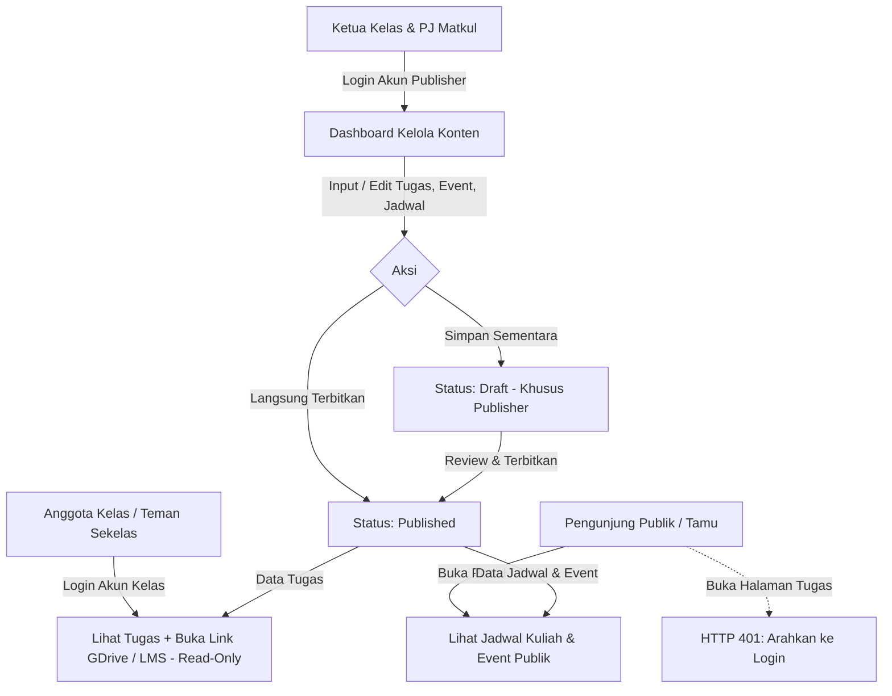

# PRD — Chosenwan

- **Versi:** 1.5
- **Tanggal:** 2026-11-24
- **Status:** Approved (Revisi Akses Gated Task & Akun Anggota Kelas v1.5)
- **Sumber input:** `01-discovery.md` v1.0, `02-opportunity.md` v1.0, `03-scope.md` v1.2, dokumen desain database ERD serah-terima, dan keputusan pengguna (2026-11-20 & 2026-11-24).
- **Skill digunakan:** `prd-writer`, `antislop-copywriting`

## TL;DR

Chosenwan adalah portal web mobile-first untuk satu kelas pilot agar mahasiswa bisa mengecek tugas, jadwal statis kuliah, serta pengumuman/event kelas (termasuk **perubahan jadwal insidental**, **Berita Kampus**, dan **Info Lomba**) tanpa menggali chat WhatsApp atau menunggu teman membalas. 

Pada revisi v1.5, akses portal dibagi menjadi dua lapis keamanan:
1. **Area Publik (Tanpa Login):** Menampilkan **Jadwal Kuliah Statis** dan **Event / Info Kampus & Lomba**.
2. **Area Khusus Anggota Kelas (Wajib Login):** Menampilkan **Daftar & Detail Tugas (Task)** beserta tautan pengumpulan (Google Drive / LMS). Akses ini di-gated untuk menjaga privasi kelas dan mencegah pihak luar/kelas lain mengakses tautan pengumpulan kelas. Anggota kelas berstatus *read-only*.
3. **Pengurus Kelas (Ketua Kelas & PJ Mata Kuliah):** Login dengan peran publisher untuk membuat, mengedit, menyimpan `Draft`, atau langsung menerbitkan (*self-publish*) informasi tanpa bottleneck persetujuan bertingkat.

## 1. Problem Statement

Mahasiswa di kelas pengguna kesulitan mencari kembali tugas, pengumuman dosen, dan jadwal kuliah karena informasi tersebar di beberapa kanal dan tertumpuk di chat WhatsApp. Mereka mencari lewat fitur search atau meminta teman mengirim ulang. Pengguna mengatakan pencarian sulit dan balasan teman bisa lama. Teman di grup pernah meminta tugas dikirim ulang karena sulit ditemukan.

Informasi yang tersedia berasal dari pengalaman pengguna dan cerita tentang grup kelas. Frekuensi masalah belum dihitung; PRD ini membatasi produk untuk pilot satu kelas dan tidak mengklaim masalah mewakili seluruh kampus.

## 2. Goals

- Membantu mahasiswa kelas mengakses tugas kuliah dan tautan pengumpulan (Google Drive / LMS) secara aman dalam wadah tertutup khusus kelas tanpa risiko diakses pihak luar.
- Membantu mahasiswa dan publik melihat jadwal kuliah statis (hari, jam, mata kuliah, ruangan, dosen) serta informasi event (berita kampus & info lomba) di satu tempat.
- Memungkinkan ketua kelas dan PJ mata kuliah mengelola dan menerbitkan informasi secara langsung dengan kontrol penuh atas keakuratan konten.

## 3. Target Users

### Pengunjung Publik (Tamu)

**Description:** Siapa saja yang membuka website tanpa login (misal dosen, mahasiswa luar, atau mahasiswa kelas yang belum login).

**Need:** Melihat jadwal kuliah kelas dan agenda event/lomba kampus.

**Context:** Membuka portal langsung dari browser ponsel tanpa login. Tidak memiliki akses ke daftar tugas kelas.

### Anggota Kelas (Mahasiswa Kelas Pilot)

**Description:** Teman sekelas terdaftar yang memiliki akun login kelas (`role = member`).

**Need:** Melihat detail tugas, tenggat deadline, instruksi pengerjaan, dan membuka tautan pengumpulan (Google Drive / LMS).

**Context:** Login menggunakan nama akun dan password kelas. Memiliki hak akses *Read-Only* (tidak dapat mengubah/menghapus konten kelas).

### Ketua Kelas dan PJ Mata Kuliah (Publisher)

**Description:** Pengurus kelas yang ditugaskan mengelola informasi akademik (`role = pj` dan `role = ketua_kelas`).

**Need:** Menambahkan atau memperbarui informasi tugas, event/pengumuman, dan jadwal statis, memilih kategori, serta langsung menerbitkan atau menyimpan draft.

**Context:** Menerima arahan dari dosen atau kanal kampus, lalu mempublikasikannya ke portal.

## 4. User Stories

- As a pengunjung publik, I want to melihat jadwal statis kuliah dan informasi event kampus/lomba, so that gue bisa mengecek agenda umum kelas tanpa hambatan login.
- As a anggota kelas, I want to login dengan akun kelas gue, so that gue bisa melihat tugas kuliah dan link pengumpulan Google Drive secara privat tanpa bocor ke pihak luar.
- As a anggota kelas, I want to melihat detail tugas, deadline, dan link pengumpulan, so that gue tahu apa yang harus dikerjakan dan ke mana mengumpulkannya.
- As a ketua kelas atau PJ mata kuliah, I want to membuat dan langsung menerbitkan tugas, event/pengumuman, atau jadwal, so that informasi cepat sampai ke teman sekelas.
- As a ketua kelas atau PJ mata kuliah, I want to menyimpan informasi sebagai draft sementara jika belum siap tayang, so that informasi yang belum pasti tidak langsung terlihat oleh anggota kelas.

## 5. Functional Requirements

### FR-01 — Akses Informasi Publik & Gated Task

**Requirement:** Publik MUST dapat melihat informasi Jadwal dan Event berstatus `Published` tanpa login. Halaman dan data Tugas (Task) MUST di-gated dan hanya dapat diakses oleh pengguna yang telah login (Anggota Kelas & Publisher). Informasi berstatus `Draft` MUST NOT tampil di area publik maupun anggota kelas.

**Acceptance Criteria:**
- Pengunjung tanpa login dapat membuka halaman Jadwal dan Event yang berstatus `Published`.
- Akses ke halaman atau endpoint data Tugas oleh pengunjung tanpa login ditolak (HTTP 401) dan diarahkan ke halaman login.
- Data tugas dan link pengumpulan tidak boleh terkirim sama sekali ke browser pengunjung yang belum login.
- Item berstatus `Draft` hanya dapat dilihat oleh publisher (PJ/Ketua Kelas) di dashboard publisher.

**Related User Story:** Pengunjung publik story 1; Anggota kelas stories 2–3.

### FR-02 — Akses dan Otorisasi Multi-Peran (RBAC)

**Requirement:** Sistem MUST menerapkan otorisasi berbasis peran (`account.role`): `member` (Anggota Kelas), `pj` (PJ Mata Kuliah), dan `ketua_kelas` (Ketua Kelas).

**Acceptance Criteria:**
- `member`: Memiliki hak baca (*Read-Only*) untuk seluruh Tugas, Event, dan Jadwal berstatus `Published`. Tidak dapat melakukan aksi tambah, ubah, atau hapus.
- `pj`: Memiliki hak baca penuh, serta hak membuat, mengubah, dan menghapus tugas dan event yang dibuatnya sendiri (atau terkait mata kuliah binaannya).
- `ketua_kelas`: Memiliki seluruh hak akses `pj`, plus hak moderasi darurat (mengubah/menghapus konten milik publisher lain) dan hak memperbarui jadwal kuliah statis kelas.
- Pengunjung tanpa login ditolak dari seluruh endpoint mutasi (insert, update, delete).

**Related User Story:** Anggota kelas story 2; Publisher stories 4–5.

### FR-03 — Mengelola Informasi Tugas

**Requirement:** Publisher MUST dapat membuat, mengubah, dan menghapus informasi tugas yang mencakup mata kuliah (relasi ke master `course`), judul tugas, instruksi pengerjaan, tenggat (deadline tanggal & jam), dan link pengumpulan (Google Drive/LMS).

**Acceptance Criteria:**
- Form tugas mewajibkan minimal: mata kuliah, judul, instruksi, dan deadline; link pengumpulan bersifat opsional.
- Master mata kuliah dikelola secara terpusat pada tabel `course` untuk mencegah duplikasi penulisan.
- Data tugas tersimpan dengan relasi akun pembuat (`id_acc`) dan status (`DRAFT` atau `PUBLISHED`).

**Related User Story:** Anggota kelas story 3; publisher story 4.

### FR-04 — Mengelola Event dan Pengumuman (Akademik, Berita Kampus, Info Lomba)

**Requirement:** Publisher MUST dapat membuat, mengubah, dan menghapus pengumuman dan info non-tugas menggunakan satu struktur entitas `event` yang mencakup judul, kategori (`Akademik / Umum`, `Berita Kampus`, atau `Info Lomba`), mata kuliah (opsional), deskripsi, tanggal event, link sumber, dan lampiran poster/gambar (opsional).

**Acceptance Criteria:**
- Form event mendukung unggah poster/gambar (dioptimasi via CDN ImageKit.io) untuk kategori Info Lomba dan Berita Kampus.
- Item event publik menampilkan judul, badge kategori, tanggal, deskripsi, gambar poster (jika ada), dan link sumber resmi.
- Saat poster diganti atau event dihapus, sistem membersihkan file lama di storage ImageKit via `poster_file_id`.

**Related User Story:** Pengunjung publik story 1; publisher story 4.

### FR-05 — Publikasi Langsung dan Opsi Draft

**Requirement:** Publisher MUST dapat langsung menerbitkan (*publish*) tugas atau event yang dibuatnya tanpa perlu menunggu persetujuan ketua kelas. Publisher MUST juga memiliki opsi menyimpan informasi sebagai `Draft` sebelum diterbitkan.

**Acceptance Criteria:**
- Setiap form input memiliki dua aksi jelas: **Simpan Draft** (hanya terlihat oleh publisher) dan **Terbitkan** (tampil untuk anggota kelas/publik sesuai hak akses).
- Tidak ada antrean wajib approval dari ketua kelas untuk publikasi oleh PJ mata kuliah.

**Related User Story:** Publisher stories 4–5.

### FR-06 — Mengelola dan Melihat Jadwal Statis Kuliah

**Requirement:** Produk MUST menampilkan daftar jadwal statis kuliah per semester yang mencakup hari, jam mulai–selesai, mata kuliah, ruangan, dan dosen. Publisher (Ketua Kelas) MUST dapat menambahkan atau memperbarui jadwal statis tersebut bila ada perubahan permanen.

**Acceptance Criteria:**
- Jadwal statis ditampilkan terurut berdasarkan hari (Senin–Sabtu) dan jam mulai.
- Perubahan jadwal insidental (satu pertemuan) disampaikan melalui pengumuman kategori `Akademik` (`FR-04`), bukan merombak jadwal statis.

**Related User Story:** Pengunjung publik story 1; publisher story 4.

### FR-07 — Pemisahan Navigasi, Filter, dan Kebaruan Informasi

**Requirement:** Produk MUST memisahkan navigasi antara Tugas, Event & Pengumuman, dan Jadwal, serta menyediakan filter berdasarkan mata kuliah dan kategori info.

**Acceptance Criteria:**
- Navigasi utama memisahkan jelas tampilan Tugas, Event & Pengumuman, dan Jadwal.
- Jika pengguna belum login dan menekan tab Tugas, antarmuka menampilkan pintu login (*login prompt*) dengan penjelasan alasan privasi kelas.
- Filter memungkinkan pengguna menyaring daftar berdasarkan mata kuliah atau kategori info (`Akademik`, `Berita Kampus`, `Info Lomba`).

**Related User Story:** Pengunjung publik story 1; Anggota kelas stories 2–3.

## 6. Non-Functional Requirements

### NFR-01 — Mobile use

Konten inti MUST dapat dibaca dan digunakan nyaman melalui layar ponsel (mobile-first, `max-w-md mx-auto`).

### NFR-02 — Privacy & Security

Portal publik MUST NOT mengekspos daftar tugas atau tautan Google Drive kelas ke pengunjung yang belum terautentikasi. Password akun MUST disimpan dalam bentuk hash (bcrypt), bukan plain text.

### NFR-03 — Content accuracy

Informasi berstatus `Draft` MUST NOT tampil di area publik maupun anggota kelas biasa.

### NFR-04 — Performance and Media Delivery

Pengunggahan poster dioptimasi melalui kompresi client dan ditayangkan melalui CDN pihak ketiga (ImageKit.io) agar tidak membebani database dan hemat bandwidth.

## 7. Scope

### In Scope

- Portal web mobile-first untuk satu kelas pilot.
- Akses publik tanpa login khusus untuk **Jadwal Kuliah Statis** dan **Event / Berita & Lomba**.
- Akses privat berbasis login khusus untuk **Tugas (Task)** dan link pengumpulan (Google Drive / LMS).
- Sistem akun multi-peran: `member` (read-only), `pj` (editor matkul), dan `ketua_kelas` (admin/moderator).
- Form kelola konten tugas, event, dan jadwal dengan aksi ganda **Simpan Draft** vs **Terbitkan**.
- Dukungan gambar poster pada event/lomba via ImageKit.io.
- Database relasional 5 tabel: `account`, `course`, `schedule`, `task`, `event`.

### Out of Scope (Future Roadmap)

- **Scraping Otomatis Jadwal & Mata Kuliah:** Penarikan otomatis jadwal kuliah dan data dosen dari portal akademik kampus / SIAKAD secara terjadwal. Arsitektur tabel `course` dan `schedule` sudah disiapkan agar siap menerima injeksi data scraper di masa depan.
- **LLM / AI Chat Parser:** Fitur ekstraksi pesan chat WhatsApp (dari dosen/grup) langsung menjadi prefilled form tugas atau event. Arsitektur form berbasis Zod sudah kompatibel untuk menerima payload JSON dari API model bahasa di masa depan.
- Sistem kalender jadwal berulang dinamis dengan penanda libur nasional.
- Penyimpanan file tugas internal di server Chosenwan (tetap diarahkan ke Google Drive/LMS).
- Pelacakan checklist tugas pribadi per mahasiswa.
- Portal multi-kelas atau multi-fakultas.

## 8. Asumsi, Risiko, dan Pertanyaan Terbuka

- `[ASUMSI]` Akun anggota kelas dibagikan/dibuat oleh ketua kelas atau tim pengelola dengan username unik (`name`) dan password standar.
- `[ASUMSI]` Tautan pengumpulan tugas berupa Google Drive, Google Classroom, atau LMS kampus yang aman dan hanya bisa diakses oleh pemegang akun terdaftar.
- `[RISIKO]` **Lupa Password / Manajemen Akun:** Belum ada fitur reset password mandiri via email. Jika anggota lupa password, reset dilakukan manual oleh ketua kelas/admin.
- `[RISIKO]` **Beban Kurasi Event:** Info lomba dan berita kampus memerlukan inisiatif ketua kelas/PJ untuk memposting link sumber dan poster.

## Changelog

| Versi | Tanggal | Perubahan |
|---|---|---|
| 1.0 | 2026-11-11 | Draft awal PRD dari `03-scope.md`. |
| 1.1 | 2026-11-11 | Penyesuaian core features awal. |
| 1.2 | 2026-11-17 | Menambahkan TL;DR, diagram alur Mermaid, struktur simpel pengumuman non-tugas (`FR-04`), alur publikasi langsung tanpa approval ketua kelas (`FR-05`), Acceptance Criteria per FR, serta bagian Asumsi/Risiko/Pertanyaan Terbuka dan Changelog. |
| 1.3 | 2026-11-17 | Menambahkan **Berita Kampus** dan **Info Lomba** ke dalam kategori Pengumuman & Info Simpel (`FR-04`) dan filter navigasi (`FR-07`). |
| 1.4 | 2026-11-17 | Menyederhanakan `FR-06` menjadi **jadwal kuliah statis** per semester dan memindahkan info perubahan jadwal insidental ke Pengumuman & Info Simpel (`FR-04`). |
| 1.5 | 2026-11-24 | Menyesuaikan model akses: **Task di-gated khusus Anggota Kelas (login)** demi privasi link GDrive; Jadwal & Event tetap publik; menambahkan peran `member` (read-only); mengadopsi 5 tabel standar (`account`, `course`, `schedule`, `task`, `event`); mencatat fitur Scraping dan LLM Parser ke Out of Scope (Future Roadmap). |
