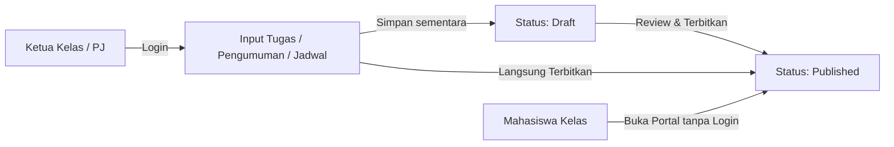

# PRD — Chosenwan

- **Versi:** 1.4
- **Tanggal:** 2026-11-17
- **Status:** Draft (Menunggu Gate 2)
- **Sumber input:** `01-discovery.md` v1.0, `02-opportunity.md` v1.0, `03-scope.md` v1.2, dan keputusan pengguna (2026-11-11 & 2026-11-17).
- **Skill digunakan:** `prd-writer`, `antislop-copywriting`

## TL;DR

Chosenwan adalah portal web mobile-first untuk satu kelas pilot agar mahasiswa bisa mengecek tugas, jadwal statis kuliah, serta pengumuman/info kelas (termasuk **perubahan jadwal insidental**, **Berita Kampus**, dan **Info Lomba**) tanpa menggali chat WhatsApp atau menunggu teman membalas. Mahasiswa membaca tanpa login, sementara ketua kelas dan PJ mata kuliah login untuk membuat dan **langsung menerbitkan** info (dengan opsi `Draft` jika perlu dicek dulu).

Revisi v1.4 menyederhanakan modul jadwal menjadi **jadwal statis per semester** (`FR-06`), sementara **perubahan jadwal insidental** diposting melalui **Pengumuman & Info Simpel** (`FR-04`) untuk memangkas kompleksitas teknis.

## 1. Problem Statement

Mahasiswa di kelas pengguna kesulitan mencari kembali tugas, pengumuman dosen, dan jadwal kuliah karena informasi tersebar di beberapa kanal dan tertumpuk di chat WhatsApp. Mereka mencari lewat fitur search atau meminta teman mengirim ulang. Pengguna mengatakan pencarian sulit dan balasan teman bisa lama. Teman di grup pernah meminta tugas dikirim ulang karena sulit ditemukan.

Informasi yang tersedia berasal dari pengalaman pengguna dan cerita tentang grup kelas. Frekuensi masalah belum dihitung; PRD ini membatasi produk untuk pilot satu kelas dan tidak mengklaim masalah mewakili seluruh kampus.

## 2. Goals

- Membantu mahasiswa menemukan detail tugas, pengumuman dosen (termasuk perubahan jadwal insidental), berita kampus, dan info lomba tanpa menggali chat panjang, tertinggal info karena *misscom*, atau menunggu teman membalas.
- Membantu mahasiswa melihat jadwal kuliah statis beserta hari, jam, mata kuliah, kelas/ruangan, dan dosen di satu tempat.
- Memungkinkan ketua kelas dan PJ mata kuliah mengelola dan menerbitkan informasi secara langsung dengan kontrol penuh atas keakuratan konten.

## 3. Target Users

### Mahasiswa kelas

**Description:** Mahasiswa pada satu kelas pilot.

**Need:** Melihat dan menemukan kembali tugas, pengumuman dosen, jadwal kelas, berita kampus, serta info lomba yang relevan.

**Context:** Informasi kuliah sering tertumpuk di grup WhatsApp, berita kampus sering *misscom* karena tersebar di banyak kanal, dan sebagian teman kelas belum pernah mengikuti lomba karena akses info kurang terpusat `[ASUMSI]`. Mahasiswa membuka portal tanpa login.

### Ketua kelas dan PJ mata kuliah

**Description:** Publisher yang menerima informasi dari dosen atau mengkurasi info kampus/lomba lalu meneruskannya ke kelas.

**Need:** Menambahkan atau memperbarui informasi tugas, pengumuman/info simpel, dan jadwal, memilih kategori secara manual, serta langsung menerbitkan (atau menyimpan sementara sebagai draft) tanpa bottleneck persetujuan berlapis.

**Context:** Saat ini mereka menerima informasi lewat WhatsApp dan meneruskannya ke grup kelas. Mereka login untuk mengelola portal.

## 4. User Stories

- As a mahasiswa kelas, I want to melihat daftar tugas, pengumuman, berita kampus, dan info lomba berdasarkan kategori/mata kuliah, so that gue bisa menemukan info tanpa mencari lama di chat atau ketinggalan *misscom* kampus.
- As a mahasiswa kelas, I want to melihat detail tugas, deadline, dan tempat pengumpulan, so that gue tahu apa yang harus dikerjakan dan ke mana mengumpulkannya.
- As a mahasiswa kelas, I want to melihat jadwal statis kuliah beserta waktu, ruangan, dan dosen, so that gue bisa mengecek jadwal rutin di satu tempat tanpa harus tanya ulang di grup.
- As a ketua kelas atau PJ mata kuliah, I want to membuat dan langsung menerbitkan tugas, pengumuman/info simpel (akademik, berita kampus, info lomba), atau update jadwal, so that informasi cepat sampai ke kelas tanpa perlu menunggu approval pihak lain.
- As a ketua kelas atau PJ mata kuliah, I want to menyimpan informasi sebagai draft sementara jika belum siap tayang, so that informasi yang belum pasti tidak langsung terlihat mahasiswa.

## 5. Functional Requirements

### FR-01 — Akses informasi publik

**Requirement:** Mahasiswa MUST dapat melihat informasi berstatus `Published` tanpa login. Informasi berstatus `Draft` MUST NOT tampil di area publik.

**Acceptance Criteria:**
- Pengunjung tanpa login dapat membuka halaman tugas, pengumuman, dan jadwal yang berstatus `Published`.
- Item berstatus `Draft` tidak muncul di daftar publik maupun hasil pencarian/filter publik, dan tidak dapat diakses langsung lewat URL publik.

**Related User Story:** Mahasiswa kelas, stories 1–3.

### FR-02 — Akses dan otorisasi publisher

**Requirement:** Ketua kelas dan PJ mata kuliah MUST login untuk membuat, mengubah, menerbitkan, atau menghapus informasi. Pengunjung tanpa login MUST NOT dapat mengelola konten.

**Acceptance Criteria:**
- Akses ke halaman/endpoint kelola konten ditolak untuk user yang belum login.
- `[ASUMSI]` Setiap publisher dapat mengedit dan menghapus postingan yang dibuatnya sendiri; ketua kelas memiliki hak edit/hapus untuk seluruh postingan kelas sebagai *fallback* bila PJ berhalangan.

**Related User Story:** Publisher, stories 4–5.

### FR-03 — Mengelola informasi tugas

**Requirement:** Publisher MUST dapat membuat, mengubah, dan menghapus informasi tugas yang mencakup mata kuliah (dipilih manual), minggu ke-*n*, judul/detail instruksi, deadline (tanggal dan jam), tempat atau link pengumpulan, serta lampiran/referensi bila ada.

**Acceptance Criteria:**
- Form tugas mewajibkan minimal: mata kuliah, detail/instruksi, dan deadline; field minggu, link/lokasi pengumpulan, dan lampiran bersifat opsional atau sesuai ketersediaan info dosen.
- `[ASUMSI]` Daftar mata kuliah kelas pilot dikelola di awal oleh ketua kelas/publisher agar pilihan kategori manual tetap konsisten dan tidak menghasilkan duplikat penamaan.

**Related User Story:** Mahasiswa kelas stories 1–2; publisher story 4.

### FR-04 — Mengelola pengumuman dan info simpel (Akademik, Perubahan Jadwal, Berita Kampus, Info Lomba)

**Requirement:** Publisher MUST dapat membuat, mengubah, dan menghapus pengumuman dan info non-tugas menggunakan satu struktur simpel yang mencakup judul, kategori info (`Akademik / Umum`, `Berita Kampus`, atau `Info Lomba`), kategori mata kuliah (opsional, khusus untuk pengumuman akademik/perubahan jadwal), isi ringkas, dan lampiran/link sumber opsional.

**Acceptance Criteria:**
- Publisher dapat mempublikasikan pengumuman dosen, info perubahan jadwal insidental (pindah ruang, ganti jam, kelas online, atau batal), berita kampus, maupun info lomba lewat satu form yang sama tanpa harus mengisi field khusus tugas seperti minggu ke-*n* atau deadline pengumpulan tugas.
- Pengumuman publik menampilkan judul, badge kategori info (`Akademik / Umum`, `Berita Kampus`, atau `Info Lomba`), label mata kuliah (bila dipilih), waktu publikasi/pembaruan, isi ringkas, dan link/lampiran sumber bila ada.
- Untuk `Berita Kampus` dan `Info Lomba`, publisher SHOULD menyertakan link sumber resmi (IG/web/pengumuman resmi) bila tersedia agar keaslian informasi dapat diverifikasi.

**Related User Story:** Mahasiswa kelas story 1; publisher story 4.

### FR-05 — Publikasi langsung dan opsi Draft

**Requirement:** Publisher MUST dapat langsung menerbitkan (*publish*) informasi yang dibuatnya tanpa perlu menunggu persetujuan ketua kelas. Publisher MUST juga memiliki opsi menyimpan informasi sebagai `Draft` sebelum diterbitkan. Jika kelak ringkasan otomatis digunakan, sistem MUST menyimpan sumber pesan asli agar publisher dapat membandingkannya sebelum publish.

**Acceptance Criteria:**
- Setiap form input memiliki dua aksi jelas: **Simpan Draft** (hanya terlihat oleh publisher) dan **Terbitkan** (langsung tampil di portal publik).
- Tidak ada antrean wajib approval dari ketua kelas untuk publikasi oleh PJ mata kuliah.

**Related User Story:** Publisher stories 4–5.

### FR-06 — Mengelola dan melihat jadwal statis kuliah

**Requirement:** Produk MUST menampilkan daftar jadwal statis kuliah per semester yang mencakup hari, jam mulai–selesai, mata kuliah, kelas/ruangan, dan dosen. Publisher MUST dapat menambahkan atau memperbarui jadwal statis tersebut bila ada perubahan permanen. Perubahan jadwal insidental (satu pertemuan) disampaikan melalui pengumuman (`FR-04`), bukan lewat sistem *override* tanggal di jadwal.

**Acceptance Criteria:**
- Jadwal statis ditampilkan terurut berdasarkan hari dan jam mulai.
- Sistem tidak membutuhkan logika tanggal kalender berulang atau *override* jadwal per pertemuan; perubahan jadwal sementara diposting sebagai pengumuman kategori `Akademik / Umum` (`FR-04`).

**Related User Story:** Mahasiswa kelas story 3; publisher story 4.

### FR-07 — Pemisahan akses, filter, dan kebaruan informasi

**Requirement:** Produk MUST memisahkan akses/navigasi antara tugas, pengumuman/info (akademik, berita kampus, info lomba), dan jadwal, serta menampilkan nama mata kuliah atau kategori info dan waktu publikasi/pembaruan. Pencarian dan filter berdasarkan mata kuliah serta kategori info SHOULD disediakan.

**Acceptance Criteria:**
- Navigasi utama memisahkan jelas tampilan Tugas, Pengumuman & Info, dan Jadwal (agar info lomba dan berita kampus tidak menenggelamkan tugas kuliah).
- Daftar tugas diurutkan secara jelas (misal berdasarkan deadline terdekat) dan memisahkan atau menandai tugas yang sudah lewat deadline.
- Filter memungkinkan mahasiswa menyaring daftar berdasarkan mata kuliah atau kategori info (`Akademik / Umum`, `Berita Kampus`, `Info Lomba`).

**Related User Story:** Mahasiswa kelas stories 1–3.

## 6. Non-Functional Requirements

### NFR-01 — Mobile use

Konten inti MUST dapat dibaca dan digunakan nyaman melalui layar ponsel (mobile-first). Detail kompatibilitas browser: **TBD**.

### NFR-02 — Privacy

Portal publik MUST NOT menampilkan data pribadi mahasiswa atau informasi rahasia. Pengguna menyatakan konten pilot seputar mata kuliah tidak rahasia.

### NFR-03 — Content accuracy

Informasi berstatus `Draft` MUST NOT tampil di area publik. Jika fitur bantuan ringkasan otomatis diaktifkan pada iterasi mendatang, pesan asli MUST tetap tersedia di tampilan editor publisher untuk pemeriksaan sebelum publish.

### NFR-04 — Performance and availability

Target waktu respons, kapasitas, dan ketersediaan: **TBD**. Jangan menganggap target angka sebelum ditentukan.

## 7. Scope

### In Scope

- Portal web mobile-first untuk satu kelas pilot.
- Akses publik mahasiswa tanpa login.
- Login untuk ketua kelas dan PJ mata kuliah sebagai publisher (self-publish langsung tanpa approval berjenjang, dengan opsi `Draft`).
- Informasi **tugas**: mata kuliah, minggu (opsional), isi/instruksi, deadline, link/tempat pengumpulan, referensi/lampiran opsional.
- Informasi **pengumuman & info simpel**: satu format ringan untuk pengumuman dosen/umum (termasuk perubahan jadwal insidental), **Berita Kampus**, dan **Info Lomba** (judul, kategori info, mata kuliah opsional, isi, lampiran/link sumber opsional).
- **Jadwal kuliah statis**: hari, jam mulai–selesai, mata kuliah, kelas/ruangan, dan dosen.
- Kategori mata kuliah dan kategori info dipilih publisher secara manual.
- Pemisahan tampilan tugas, pengumuman/info, dan jadwal, waktu pembaruan, serta pencarian/filter mata kuliah dan kategori info (`Should have`).

### Out of Scope

- Sistem kalender jadwal berulang dengan *override* atau penanda perubahan per tanggal pertemuan.
- Modul event/lomba terpisah (pendaftaran lomba, pencari teman tim, pengingat otomatis, kalender lomba).
- Scraping atau sinkronisasi otomatis berita kampus/lomba dari Instagram atau website kampus.
- Tracking progres atau status pengumpulan tugas mahasiswa.
- Pengumpulan file tugas di dalam portal.
- Workflow approval berjenjang oleh ketua kelas sebelum PJ bisa menerbitkan konten.
- Publikasi otomatis dari AI/forward WA tanpa aksi terbit dari publisher.
- Kategori mata kuliah ditentukan otomatis oleh AI sebagai keputusan final.
- Integrasi langsung WhatsApp atau pemilihan vendor/model AI tertentu di tahap ini.
- Oprec lab sebagai prioritas MVP.
- Dukungan banyak kelas atau portal seluruh kampus.
- Target numerik performa atau metrik keberhasilan yang belum memiliki baseline.

## 8. Asumsi, Risiko, dan Pertanyaan Terbuka

- `[ASUMSI]` Hak edit/hapus konten berlaku untuk pembuatnya sendiri plus ketua kelas untuk seluruh konten kelas.
- `[ASUMSI]` Menaruh **Info Lomba** lewat format pengumuman simpel meningkatkan *awareness* mahasiswa kelas, meski belum tervalidasi apakah alasan belum ikut lomba hanya karena kurang informasi atau faktor lain (tim, percaya diri, waktu).
- `[RISIKO]` **Adopsi & Beban Kurasi Publisher:** Selain input info kuliah manual, berita kampus dan info lomba tidak datang otomatis dari dosen sehingga butuh kurasi manual publisher. Jika terlalu berat atau info kedaluwarsa menumpuk, portal cepat kehilangan kepercayaan.
- `[RISIKO]` **Akurasi Berita Kampus & Lomba:** Tanpa pencantuman link sumber resmi (IG/web kampus), informasi berisiko *misscom* ulang.
- `[PERTANYAAN]` Apa nama/identitas kelas pilot, dan siapa saja daftar mata kuliah semester berjalan untuk opsi kategori awal?
- `[PERTANYAAN]` Apakah PJ mata kuliah boleh saling mengedit postingan lintas mata kuliah, atau cukup pembuat asli + ketua kelas?
- `[PERTANYAAN]` Siapa di antara ketua kelas/PJ/tim pengelola yang bertanggung jawab mengkurasi berita kampus dan info lomba agar konsisten update?

## Changelog

| Versi | Tanggal | Perubahan |
|---|---|---|
| 1.0 | 2026-11-11 | Draft awal PRD dari `03-scope.md`. |
| 1.1 | 2026-11-11 | Penyesuaian core features awal. |
| 1.2 | 2026-11-17 | Menambahkan TL;DR, diagram alur Mermaid, struktur simpel pengumuman non-tugas (`FR-04`), alur publikasi langsung tanpa approval ketua kelas (`FR-05`), Acceptance Criteria per FR, serta bagian Asumsi/Risiko/Pertanyaan Terbuka dan Changelog. |
| 1.3 | 2026-11-17 | Menambahkan **Berita Kampus** dan **Info Lomba** ke dalam kategori Pengumuman & Info Simpel (`FR-04`) dan filter navigasi (`FR-07`) sesuai keputusan pengguna tanpa membuat modul event terpisah; menambahkan risiko kurasi dan verifikasi sumber. |
| 1.4 | 2026-11-17 | Menyederhanakan `FR-06` menjadi **jadwal kuliah statis** per semester dan memindahkan info perubahan jadwal insidental ke Pengumuman & Info Simpel (`FR-04`). |
