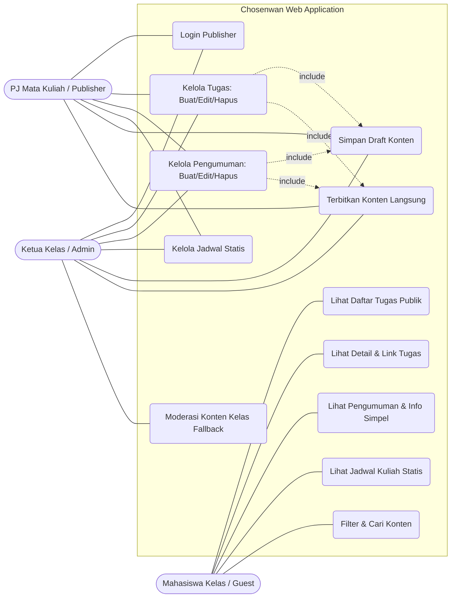
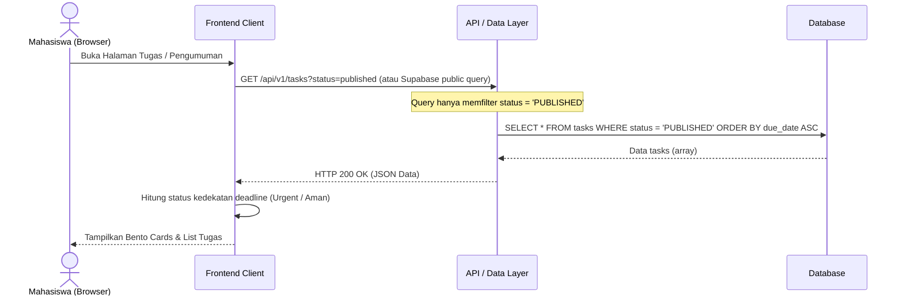
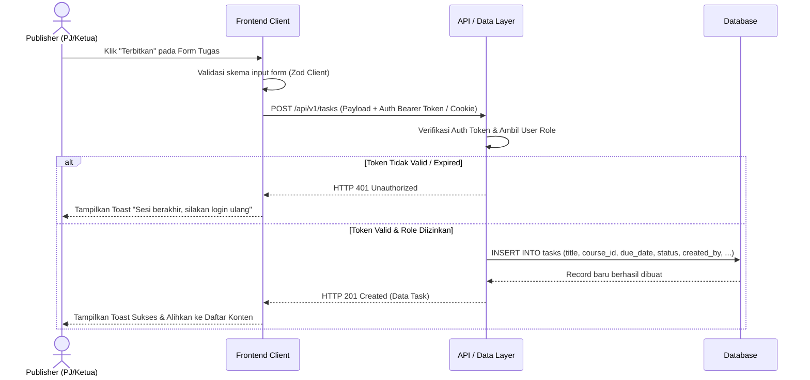
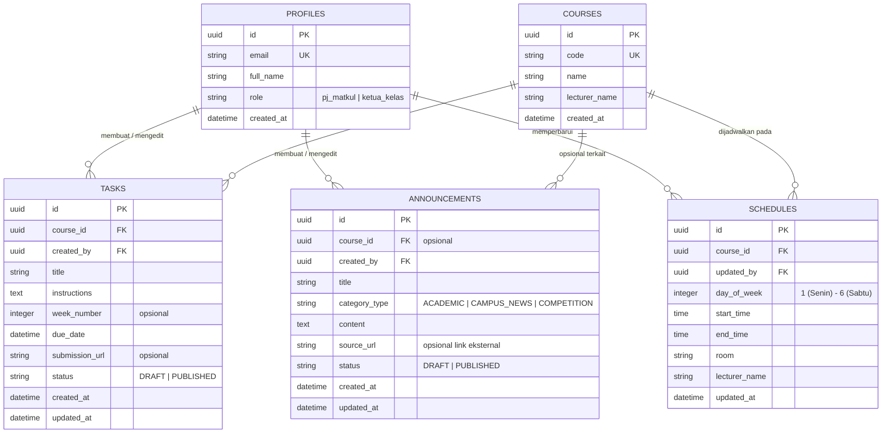
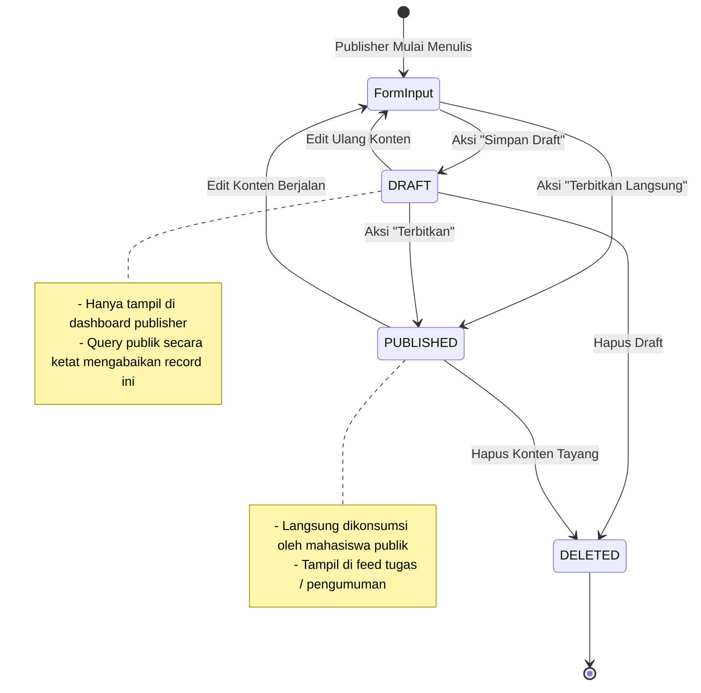

# Spec Teknis: Chosenwan

- **Versi:** 1.1
- **Tanggal:** 2026-11-17
- **Status:** Approved (Disetujui pada Gate 3)
- **Sumber input:** `04-prd.md` v1.4, `03-scope.md` v1.2, `05-design.md` v1.0, `project-context.md`, dan keputusan Lead PM (Tech Stack Opsi A).
- **Skill digunakan:** `spec-writer`, `antislop-copywriting`

---

## TL;DR

Chosenwan adalah portal web mobile-first untuk satu kelas pilot yang menyajikan tugas kuliah, jadwal statis per semester, dan pengumuman/info simpel (akademik, perubahan jadwal insidental, berita kampus, dan info lomba) dalam satu wadah terkurasi. 

Mahasiswa mengakses portal secara instan tanpa login (publik read-only), sementara publisher (ketua kelas dan PJ mata kuliah) login menggunakan otentikasi berbasis peran untuk membuat, menyimpan draft, atau langsung menerbitkan (*self-publish*) informasi tanpa bottleneck persetujuan bertingkat. 

Bagian paling kompleks terletak pada pemisahan otorisasi mutasi konten (RLS/role check) dengan feed publik berlatensi rendah serta manajemen form multi-kategori yang ringan di ponsel. 

Dokumen ini mendefinisikan arsitektur teknis, diagram alur sistem, data model, kontrak API, pemetaan komponen UI ke library standar, penanganan edge case, dan usulan 2 opsi tech stack untuk diputuskan pada Gate 3.

---

## 1. Ringkasan

### 1.1 Tujuan Produk
Menghilangkan friksi pencarian informasi kuliah yang tertimbun di grup chat WhatsApp atau kanal kampus yang terpecah, sehingga mahasiswa kelas pilot dapat mengecek deadline tugas, jadwal harian, pengumuman dosen, serta peluang lomba secara cepat dan akurat dalam hitungan detik dari ponsel.

### 1.2 Cakupan Fitur MVP
1. **Akses Publik Mahasiswa (FR-01, FR-07):** Akses baca tanpa login ke seluruh konten berstatus `Published` (tab Tugas, tab Info & Kampus, dan tab Jadwal Statis) dengan fitur pencarian dan filter kategori.
2. **Otentikasi Publisher (FR-02):** Login aman khusus ketua kelas dan penanggung jawab (PJ) mata kuliah.
3. **Manajemen Tugas (FR-03):** Input, update, dan hapus tugas dengan atribut mata kuliah, minggu pertemuan, instruksi, tenggat (deadline), dan link pengumpulan.
4. **Manajemen Pengumuman & Info Simpel (FR-04):** Satu format entri ringan untuk pengumuman dosen, perubahan jadwal dadakan/insidental, kurasi berita kampus, dan info lomba.
5. **Alur Publikasi Fleksibel (FR-05):** Opsi simpan sebagai `Draft` (hanya terlihat oleh publisher) atau langsung terbitkan (`Published`).
6. **Jadwal Statis Kuliah (FR-06):** Penyajian jadwal terstruktur per hari (Senin-Sabtu) per semester tanpa kompleksitas recurrence kalender dinamis.

### 1.3 Status Tech Stack (Approved)
Sesuai keputusan Lead PM pada Gate 3, tech stack resmi dikunci pada **Opsi A**:
- **Framework:** Next.js (App Router, TypeScript, React 19)
- **Styling & UI Library:** Tailwind CSS + shadcn/ui + Lucide React
- **Backend & Database:** Supabase (Managed PostgreSQL, Supabase Auth, Row Level Security / RLS)
- **Deployment Platform:** Vercel (Frontend & Server Actions) + Supabase Cloud Free Tier (DB & Auth)

---

## 2. Aktor Sistem

| Aktor | Deskripsi | Hak Akses Utama |
|---|---|---|
| **Mahasiswa Kelas (Guest / Public)** | Mahasiswa aktif di kelas pilot yang membutuhkan kepastian info kuliah harian. | - Membaca konten berstatus `Published` pada tab Tugas, Info & Kampus, dan Jadwal.<br>- Mencari dan memfilter tugas atau info berdasarkan mata kuliah dan kategori.<br>- Membuka tautan pengumpulan tugas atau sumber resmi info. |
| **PJ Mata Kuliah (Publisher)** | Mahasiswa yang ditunjuk mengoordinasikan satu atau lebih mata kuliah tertentu. | - Hak akses publik penuh.<br>- Login ke dashboard publisher.<br>- Membuat konten tugas, pengumuman, dan jadwal.<br>- Menyimpan konten sebagai `Draft` atau langsung `Published`.<br>- Mengedit dan menghapus konten buatannya sendiri. |
| **Ketua Kelas (Lead Publisher / Admin)** | Koordinator utama kelas pilot yang memegang tanggung jawab kelancaran informasi seluruh kelas. | - Seluruh hak akses PJ Mata Kuliah.<br>- Hak edit dan hapus darurat (*fallback moderator*) untuk seluruh konten kelas jika PJ berhalangan.<br>- Menambah atau memperbarui slot jadwal kuliah statis kelas. |

---

## 3. Use Case Diagram (User Diagram)



### Tabel Rincian Use Case

| ID | Nama Use Case | Aktor | Prasyarat | Hasil Akhir | Prioritas MVP |
|---|---|---|---|---|---|
| **UC-01** | Lihat Daftar Tugas Publik | Mahasiswa Kelas | Mengakses URL portal | Daftar tugas `Published` tampil terurut tenggat waktu terdekat. | Must Have |
| **UC-02** | Buka Detail & Link Tugas | Mahasiswa Kelas | Tugas terdaftar di sistem | Mahasiswa melihat instruksi lengkap dan dapat mengeklik URL pengumpulan. | Must Have |
| **UC-03** | Lihat Info & Pengumuman | Mahasiswa Kelas | Mengakses tab Info | Menampilkan daftar pengumuman dosen, berita kampus, dan lomba dengan badge kategori. | Must Have |
| **UC-04** | Lihat Jadwal Statis | Mahasiswa Kelas | Mengakses tab Jadwal | Jadwal kuliah per hari tampil urut jam mulai. | Must Have |
| **UC-05** | Filter & Cari Konten | Mahasiswa Kelas | Konten tersedia | Daftar tugas/pengumuman tersaring berdasarkan keyword atau kategori pill. | Should Have |
| **UC-06** | Login Publisher | PJ, Ketua Kelas | Memiliki kredensial email/password valid | Sesi login aktif, diarahkan ke dashboard kelola info. | Must Have |
| **UC-07** | Kelola Tugas | PJ, Ketua Kelas | Login berhasil | Data tugas tersimpan di database dengan status `Draft` atau `Published`. | Must Have |
| **UC-08** | Kelola Pengumuman & Info | PJ, Ketua Kelas | Login berhasil | Data pengumuman tersimpan di database dengan kategori relevan. | Must Have |
| **UC-09** | Kelola Jadwal Statis | PJ, Ketua Kelas | Login berhasil | Data jadwal hari/jam/ruang tersimpan per semester. | Must Have |
| **UC-10** | Simpan Draft | PJ, Ketua Kelas | Input form terisi minimal | Konten tersimpan dengan `status = DRAFT`, tidak bisa dibaca publik. | Must Have |
| **UC-11** | Terbitkan Langsung | PJ, Ketua Kelas | Form valid lengkap | Konten tersimpan dengan `status = PUBLISHED`, langsung tampil di feed publik. | Must Have |
| **UC-12** | Moderasi Fallback Kelas | Ketua Kelas | Login sebagai role `admin` | Ketua kelas dapat memperbaiki atau menghapus postingan milik PJ lain yang berhalangan. | Must Have |

---

## 4. User Flow

### 4.1 Alur Pengalaman Mahasiswa (Konsumsi Informasi Publik)


### 4.2 Alur Pengalaman Publisher (Login, Input, dan Terbit)


---

## 5. Activity Diagram

### 5.1 Proses Input dan Publikasi Konten (Multi-Lane)


### Aturan Bisnis Terkait Publikasi:
1. **Self-Publishing Rights:** PJ mata kuliah dan ketua kelas memiliki hak terbit langsung tanpa antrean persetujuan (*no approval bottleneck*).
2. **Karantina Draft:** Konten dengan status `DRAFT` secara mutlak tidak boleh dikembalikan oleh query publik.
3. **Validasi Wajib Tugas:** Form tugas wajib mengisi `course_id`, `title`, dan `due_date`. Field `week_number`, `submission_url`, dan `notes` bersifat opsional.
4. **Validasi Wajib Info Simpel:** Form info simpel wajib mengisi `title`, `category_type` (`ACADEMIC`, `CAMPUS_NEWS`, atau `COMPETITION`), dan `content`. Khusus kategori `ACADEMIC`, field `course_id` opsional tetapi disarankan. Field link sumber eksternal (`source_url`) opsional namun disarankan untuk berita dan lomba.

---

## 6. Sequence Diagram

### 6.1 Konsumsi Feed Publik oleh Mahasiswa (Guest)



### 6.2 Mutasi Pembuatan Tugas oleh Publisher



---

## 7. Data Model (Database Schema)

### 7.1 Entity Relationship Diagram



### 7.2 Rincian Spesifikasi Tabel dan Field

#### Tabel: `profiles`
Menyimpan identitas publisher yang memiliki akses tulis ke dalam portal.

| Nama Kolom | Tipe Data | Constraint | Keterangan |
|---|---|---|---|
| `id` | `UUID` | PK, references `auth.users` | ID unik publisher (terhubung dengan engine otentikasi). |
| `email` | `VARCHAR(255)` | Unique, Not Null | Alamat email terdaftar. |
| `full_name` | `VARCHAR(150)` | Not Null | Nama lengkap publisher (contoh: "Andi (PJ Pemrograman Web)"). |
| `role` | `VARCHAR(30)` | Not Null, Check in (`pj_matkul`, `ketua_kelas`) | Penentu hak otorisasi moderasi konten. |
| `created_at` | `TIMESTAMP WITH TIME ZONE` | Default `NOW()` | Waktu pembuatan akun publisher. |

#### Tabel: `courses`
Daftar mata kuliah aktif kelas pilot untuk mencegah duplikasi penulisan nama mata kuliah.

| Nama Kolom | Tipe Data | Constraint | Keterangan |
|---|---|---|---|
| `id` | `UUID` | PK, Default `uuid_generate_v4()` | ID unik mata kuliah. |
| `code` | `VARCHAR(20)` | Unique, Not Null | Kode mata kuliah (contoh: `IF2140`, `MK-01`). |
| `name` | `VARCHAR(150)` | Not Null | Nama lengkap mata kuliah. |
| `lecturer_name` | `VARCHAR(150)` | Nullable | Dosen pengampu utama. |
| `created_at` | `TIMESTAMP WITH TIME ZONE` | Default `NOW()` | Waktu penambahan mata kuliah. |

#### Tabel: `tasks`
Entitas tugas terstruktur untuk mahasiswa.

| Nama Kolom | Tipe Data | Constraint | Keterangan |
|---|---|---|---|
| `id` | `UUID` | PK, Default `uuid_generate_v4()` | ID unik tugas. |
| `course_id` | `UUID` | FK -> `courses.id`, Not Null | Relasi ke mata kuliah terkait. |
| `created_by` | `UUID` | FK -> `profiles.id`, Not Null | ID publisher pembuat konten. |
| `title` | `VARCHAR(200)` | Not Null | Judul tugas (contoh: "Tugas 3: ERD Sistem Kasir"). |
| `instructions` | `TEXT` | Not Null | Deskripsi rincian dan instruksi tugas. |
| `week_number` | `INTEGER` | Nullable | Indikator pertemuan/minggu ke-*n*. |
| `due_date` | `TIMESTAMP WITH TIME ZONE` | Not Null, Index | Waktu tenggat pengumpulan tugas. |
| `submission_url` | `VARCHAR(500)` | Nullable | Tautan pengumpulan (Google Classroom/Drive/LMS). |
| `status` | `VARCHAR(20)` | Not Null, Default `'PUBLISHED'`, Index | Status: `'DRAFT'` atau `'PUBLISHED'`. |
| `created_at` | `TIMESTAMP WITH TIME ZONE` | Default `NOW()` | Timestamp pembuatan entri. |
| `updated_at` | `TIMESTAMP WITH TIME ZONE` | Default `NOW()` | Timestamp pengeditan terakhir. |

#### Tabel: `announcements`
Entitas tunggal multi-kategori untuk pengumuman dosen, perubahan jadwal insidental, berita kampus, dan info lomba.

| Nama Kolom | Tipe Data | Constraint | Keterangan |
|---|---|---|---|
| `id` | `UUID` | PK, Default `uuid_generate_v4()` | ID unik pengumuman. |
| `course_id` | `UUID` | FK -> `courses.id`, Nullable | Opsional; terisi jika pengumuman terkait matkul tertentu. |
| `created_by` | `UUID` | FK -> `profiles.id`, Not Null | ID publisher pembuat pengumuman. |
| `title` | `VARCHAR(250)` | Not Null | Judul pengumuman / berita / nama lomba. |
| `category_type` | `VARCHAR(30)` | Not Null, Index | Enum: `'ACADEMIC'`, `'CAMPUS_NEWS'`, `'COMPETITION'`. |
| `content` | `TEXT` | Not Null | Isi ringkas pengumuman atau rincian lomba/berita. |
| `source_url` | `VARCHAR(500)` | Nullable | Link sumber resmi (Instagram kampus, website lomba). |
| `status` | `VARCHAR(20)` | Not Null, Default `'PUBLISHED'`, Index | Status: `'DRAFT'` atau `'PUBLISHED'`. |
| `created_at` | `TIMESTAMP WITH TIME ZONE` | Default `NOW()` | Timestamp publikasi. |
| `updated_at` | `TIMESTAMP WITH TIME ZONE` | Default `NOW()` | Timestamp pengeditan terakhir. |

#### Tabel: `schedules`
Jadwal kuliah statis per semester.

| Nama Kolom | Tipe Data | Constraint | Keterangan |
|---|---|---|---|
| `id` | `UUID` | PK, Default `uuid_generate_v4()` | ID unik slot jadwal. |
| `course_id` | `UUID` | FK -> `courses.id`, Not Null | Relasi ke mata kuliah. |
| `updated_by` | `UUID` | FK -> `profiles.id`, Not Null | Publisher terakhir yang memperbarui jadwal. |
| `day_of_week` | `INTEGER` | Not Null, Check (1-6), Index | `1` = Senin, `2` = Selasa, ..., `6` = Sabtu. |
| `start_time` | `TIME` | Not Null | Jam kuliah dimulai (format `HH:MM`). |
| `end_time` | `TIME` | Not Null | Jam kuliah berakhir (format `HH:MM`). |
| `room` | `VARCHAR(50)` | Not Null | Nomor ruangan / laboratorium (contoh: "Lab Komputer 3"). |
| `lecturer_name` | `VARCHAR(150)` | Nullable | Dosen pengampu pada slot tersebut. |
| `updated_at` | `TIMESTAMP WITH TIME ZONE` | Default `NOW()` | Timestamp pembaruan. |

---

## 8. State Diagram

### Siklus Hidup Entitas Konten (Tugas & Pengumuman)



---

## 9. API & Interface Contract

Format API ditulis dalam pola RESTful standar (dapat diimplementasikan via REST Endpoints, Next.js Server Actions, atau Supabase Client SDK sesuai keputusan stack).

### 9.1 Ringkasan Endpoint

| Method | Endpoint Path | Autentikasi | Deskripsi Singkat | Use Case Terkait |
|---|---|---|---|---|
| `GET` | `/api/v1/tasks` | Public (Tanpa Auth) | Mengambil daftar tugas `status = PUBLISHED` | UC-01, UC-05 |
| `GET` | `/api/v1/tasks/:id` | Public (Tanpa Auth) | Mengambil detail spesifik satu tugas | UC-02 |
| `GET` | `/api/v1/announcements` | Public (Tanpa Auth) | Mengambil pengumuman & berita publik | UC-03, UC-05 |
| `GET` | `/api/v1/schedules` | Public (Tanpa Auth) | Mengambil jadwal statis kuliah per hari | UC-04 |
| `GET` | `/api/v1/courses` | Public (Tanpa Auth) | Mengambil master mata kuliah untuk filter | UC-05 |
| `POST` | `/api/v1/auth/login` | Public | Otentikasi email dan password publisher | UC-06 |
| `POST` | `/api/v1/auth/logout` | Publisher Session | Mengakhiri sesi login publisher | UC-06 |
| `GET` | `/api/v1/publisher/contents` | Publisher Session | Mengambil seluruh konten milik publisher (Draft + Published) | UC-07, UC-08 |
| `POST` | `/api/v1/tasks` | Publisher Session | Membuat entri tugas baru (Draft / Published) | UC-07, UC-10, UC-11 |
| `PUT` | `/api/v1/tasks/:id` | Publisher Session | Memperbarui entri tugas | UC-07 |
| `DELETE` | `/api/v1/tasks/:id` | Publisher Session | Menghapus entri tugas | UC-07, UC-12 |
| `POST` | `/api/v1/announcements` | Publisher Session | Membuat pengumuman / info simpel baru | UC-08, UC-10, UC-11 |
| `PUT` | `/api/v1/announcements/:id` | Publisher Session | Memperbarui pengumuman | UC-08 |
| `DELETE` | `/api/v1/announcements/:id` | Publisher Session | Menghapus pengumuman | UC-08, UC-12 |
| `PUT` | `/api/v1/schedules/:id` | Publisher Session | Memperbarui data jadwal statis | UC-09 |

---

### 9.2 Skema Request dan Response Kunci

#### 1. `GET /api/v1/tasks` (Akses Publik)
- **Query Params:**
  - `course_id` (opsional): filter ID mata kuliah.
  - `filter` (opsional): `all` | `upcoming` | `past`.
- **Response `200 OK`:**
```json
{
  "success": true,
  "data": [
    {
      "id": "e5b7b6c2-4e2b-4835-97e3-0d5b78b5e28a",
      "course": {
        "id": "c1a9f0e1-7d3a-4428-b80c-235882f0df71",
        "name": "Interaksi Manusia dan Komputer",
        "code": "IF2140"
      },
      "title": "Tugas 3: Perancangan UI Mobile High-Fidelity",
      "instructions": "Buat 4 frame aplikasi mobile menggunakan Figma. Kumpulkan file link sebelum batas waktu.",
      "week_number": 6,
      "due_date": "2026-11-20T23:59:00+07:00",
      "submission_url": "https://classroom.google.com/c/example",
      "status": "PUBLISHED",
      "created_at": "2026-11-17T08:00:00+07:00"
    }
  ]
}
```

#### 2. `POST /api/v1/tasks` (Publisher Action)
- **Headers:** `Authorization: Bearer <token>`
- **Request Body:**
```json
{
  "course_id": "c1a9f0e1-7d3a-4428-b80c-235882f0df71",
  "title": "Tugas 4: Usability Testing Report",
  "instructions": "Uji prototipe ke 3 rekan kelas dan buat ringkasan temuan dalam bentuk PDF.",
  "week_number": 7,
  "due_date": "2026-11-27T17:00:00+07:00",
  "submission_url": "https://forms.gle/example-link",
  "status": "PUBLISHED"
}
```
- **Response `201 Created`:**
```json
{
  "success": true,
  "message": "Tugas berhasil diterbitkan",
  "data": {
    "id": "f8a123bc-9921-42cb-bca1-92318049ad52",
    "status": "PUBLISHED"
  }
}
```
- **Response `400 Bad Request` (Error Validasi Form):**
```json
{
  "success": false,
  "error": "VALIDATION_ERROR",
  "details": [
    { "field": "title", "message": "Judul tugas tidak boleh kosong" },
    { "field": "due_date", "message": "Batas waktu tugas wajib diisi" }
  ]
}
```

#### 3. `POST /api/v1/announcements` (Publisher Action)
- **Request Body (Contoh: Info Lomba):**
```json
{
  "course_id": null,
  "title": "Gemastik 2026 Divisi UX Design",
  "category_type": "COMPETITION",
  "content": "Pendaftaran babak penyisihan dibuka sampai akhir bulan. Hadiah total puluhan juta rupiah.",
  "source_url": "https://pusatprestasinasional.kemdikbud.go.id/gemastik",
  "status": "PUBLISHED"
}
```
- **Response `201 Created`:**
```json
{
  "success": true,
  "message": "Info berhasil diterbitkan",
  "data": {
    "id": "a901842e-128a-4efb-8871-3382901a88b1",
    "category_type": "COMPETITION",
    "status": "PUBLISHED"
  }
}
```

---

## 10. Struktur Komponen dan Folder

Sesuai preferensi arsitektur di `profile.md` bagian 9, antarmuka Chosenwan **tidak membuat komponen custom dari nol**. Seluruh elemen dipetakan secara ketat ke library komponen siap pakai yang terawat (*radix-ui/shadcn/ui*, Tailwind CSS, dan Lucide Icons) dengan token visual dari `05-design.md`.

### 10.1 Pemetaan Kebutuhan UI ke Library Standar

| Kebutuhan UI / Fungsi | Library atau Komponen Siap Pakai | Catatan & Mapping Desain |
|---|---|---|
| **Bento Summary & Content Cards** | `shadcn/ui Card` + Tailwind utility classes | Radius besar (`rounded-2xl` / `rounded-3xl`), border tipis, flat styling tanpa drop shadow tebal. |
| **Dark Anchor Card (Urgent)** | `shadcn/ui Card` varian khusus (`bg-[#111318] text-white`) | Kartu kontras tinggi untuk tugas dengan deadline paling dekat. |
| **Navigasi Tab Halaman & Kategori** | `shadcn/ui Tabs` | Mengatur perpindahan tab `Tugas`, `Info & Kampus`, `Jadwal`, dan sub-filter kategori. |
| **Pill Badges & Status Deadline** | `shadcn/ui Badge` | Menggunakan pill penuh (`rounded-full`) dengan token warna pastel (`#A8C0FF`, `#F6C866`, `#EA9DFB`, `#4CD98B`, `#F05252`). |
| **Tombol Aksi & CTA Kapsul** | `shadcn/ui Button` | Varian kapsul penuh (`rounded-full`). Hitam `#111318` untuk aksi primer, netral `#EEF1F6` untuk sekunder. |
| **Modal Konfirmasi & Form Dialog** | `shadcn/ui Dialog` / `Sheet` (Bottom Drawer) | Bottom sheet pada mobile untuk detail tugas dan konfirmasi penghapusan data. |
| **Form Input & Textarea** | `shadcn/ui Input`, `Textarea`, `Label` | Sudut membulat `rounded-xl`, latar `#EEF1F6` / putih, fokus border `#111318`. |
| **Pilihan Dropdown Matkul** | `shadcn/ui Select` | Pemilih mata kuliah terstandarisasi saat publisher menginput tugas/pengumuman. |
| **Feedback / Toast Notifikasi** | `sonner` (atau `shadcn/ui Toast`) | Menampilkan pesan sukses *"Info berhasil diterbitkan"* atau alert error jaringan. |
| **Ikon Sistem** | `lucide-react` | Paket ikon outline seragam stroke 1.75px (`Calendar`, `Clock`, `BookOpen`, `Megaphone`, `Trophy`, `ExternalLink`, dll). |
| **Validasi Form & State** | `react-hook-form` + `zod` | Validasi skema client-side yang ketat sebelum mengirim payload ke server. |

---

### 10.2 Struktur Hierarki Komponen UI (Component Tree)

```text
AppContainer (max-w-md mx-auto, min-h-screen, bg-[#F6F7FB])
├── TopHeader (Identitas Kelas "Chosenwan Pilot", Tombol Masuk/Kelola Publisher)
├── MainContent (Dynamic View based on active tab)
│   ├── TasksView (Tab: Tugas)
│   │   ├── SearchAndFilterBar (Input Search + Course Select Filter)
│   │   ├── BentoSummaryGrid (2x2 Quick Tiles: Total, Mendesak, Berita, Lomba)
│   │   ├── UrgentTaskCard (Dark Anchor Card: bg-[#111318], Countdown Jam)
│   │   ├── TaskList (Regular White Cards)
│   │   │   └── TaskCard (Badge Matkul, Judul, Deadline, CTA Buka Link)
│   │   └── TaskDetailSheet (Bottom Sheet: Full Instructions, Copy Link)
│   │
│   ├── InfoView (Tab: Info & Kampus)
│   │   ├── CategoryPillsFilter (Semua | Akademik | Berita Kampus | Info Lomba)
│   │   └── AnnouncementList
│   │       └── AnnouncementCard (Badge Kategori Pastel, Judul, Cuplikan Isi, Source Link)
│   │
│   ├── SchedulesView (Tab: Jadwal Kuliah)
│   │   ├── DaySelectorStrip (Horizontal Days: Sen - Sab, Active Day Indicator)
│   │   └── ScheduleTimeline
│   │       └── ScheduleSlotCard (Jam Mulai-Selesai, Nama Matkul, Ruangan, Dosen)
│   │
│   └── PublisherView (Protected Route: Kelola Konten)
│       ├── PublisherTabs (Published Items | Drafts)
│       ├── ContentEditorForm
│       │   ├── ContentTypeToggle (Segmented Pill: Tugas vs Info Simpel)
│       │   ├── DynamicFields (Course, Deadline, Instructions / Category, Source URL)
│       │   └── FormActionsBar (Tombol "Simpan Draft" & Tombol Primer "Terbitkan")
│       └── DeleteConfirmDialog (Peringatan & Konfirmasi Hapus Konten)
│
└── BottomNavigationBar (Fixed Docked Pill: Tugas, Info & Kampus, Jadwal, [Kelola])
```

---

### 10.3 Struktur Folder Konvensional

Struktur folder dirancang sederhana, modular, dan mengikuti konvensi standar agar ramah untuk debugging oleh manusia maupun AI coding agent:

```text
chosenwan-app/
├── public/                     # Aset statis & favicon
├── src/
│   ├── app/                    # Routing halaman (misal Next.js App Router / Pages)
│   │   ├── layout.tsx          # Root mobile container (max-w-md center)
│   │   ├── page.tsx            # Halaman utama (Public Home / Tabs)
│   │   ├── login/
│   │   │   └── page.tsx        # Halaman autentikasi publisher
│   │   └── publisher/
│   │       └── page.tsx        # Dashboard publisher (Protected)
│   │
│   ├── components/
│   │   ├── ui/                 # Komponen dasar dari shadcn/ui (Button, Card, Badge, Dialog, etc.)
│   │   ├── layout/             # TopHeader, BottomNav, MobileContainer
│   │   ├── tasks/              # BentoGrid, UrgentTaskCard, TaskCard, TaskDetailSheet
│   │   ├── info/               # AnnouncementCard, CategoryFilter
│   │   ├── schedule/           # DaySelector, ScheduleSlotCard
│   │   └── publisher/          # ContentEditorForm, ContentTable, DeleteDialog
│   │
│   ├── lib/
│   │   ├── db.ts               # Koneksi database / Supabase client instance
│   │   ├── validations.ts      # Skema Zod untuk form tugas & pengumuman
│   │   ├── utils.ts            # Helper formatting tanggal (date-fns / dayjs) & cn helper
│   │   └── constants.ts        # Daftar hari, opsi kategori, badge colors
│   │
│   └── types/
│       └── index.ts            # TypeScript interfaces (Task, Announcement, Schedule, Course, User)
├── .env.example                # Template environment variables
├── package.json
├── tailwind.config.ts          # Definisi color tokens Playful Bento dari 05-design.md
└── tsconfig.json
```

---

## 11. Aturan Bisnis, Edge Case, dan Error Handling

| Skenario | Perilaku Sistem yang Diharapkan | Tampilan UI / Pesan Error |
|---|---|---|
| **Tidak ada tugas atau pengumuman aktif** | Sistem mendeteksi array kosong dari database. | Tampilkan *Empty State* ramah: ilustrasi minimalis + teks *"Hore, belum ada tugas aktif minggu ini! Santai dulu."* |
| **Tugas sudah lewat deadline (*past due*)** | Tugas tetap bisa diakses mahasiswa namun status deadline berubah otomatis. | Badge merah berubah menjadi abu-abu pudar bertuliskan *"Tenggat Terlewat"*; kartu bergeser ke bawah daftar. |
| **Koneksi internet terputus saat membuka portal** | Client gagal melakukan fetch data ke server. | Tampilkan banner kartu peringatan di atas: *"Gagal memuat info terbaru. Periksa koneksi internetmu."* + tombol *"Coba Lagi"*. |
| **Double Submit form oleh publisher** | Cegah duplikasi pengiriman data saat tombol ditekan berkali-kali. | Disable tombol *"Terbitkan"* / *"Simpan Draft"* seketika setelah klik pertama, ganti teks tombol dengan spinner loading. |
| **Input form tidak lengkap atau format URL salah** | Validasi client-side via Zod menolak submit form. | Highlight input yang bermasalah dengan garis merah tipis dan teks peringatan di bawah kolom (misal: *"Format tautan harus diawali https://"*). |
| **Sesi login publisher habis (Token Expired)** | Mutasi data ke backend ditolak dengan status HTTP 401. | Tampilkan Toast: *"Sesi login berakhir. Silakan masuk kembali."* dan alihkan publisher secara halus ke form login tanpa kehilangan input bila memungkinkan. |
| **Publisher non-ketua mencoba mengedit postingan orang lain** | Otorisasi di tingkat database / backend menolak query update. | HTTP 403 Forbidden. UI menampilkan pesan *"Kamu hanya dapat mengedit postingan yang kamu buat sendiri."* |
| **Tautan pengumpulan tugas berupa teks biasa** | Dosen memberikan link Google Classroom tanpa skema protokol. | Helper otomatis menyematkan prefix `https://` atau menampilkan teks petunjuk jika format bukan URL yang dapat diklik. |

---

## 12. Persyaratan Non-Fungsional (NFR)

1. **Performa & Latensi (Mobile Network Friendly):**
   - Halaman publik pertama kali dibuka (*First Contentful Paint*) ditargetkan `< 1.8 detik` pada jaringan 4G standar ponsel mahasiswa.
   - Ukuran bundel JavaScript awal diminimalkan dengan memanfaatkan *code-splitting* bawaan framework modern.
2. **Keamanan & Otorisasi:**
   - Konten berstatus `DRAFT` dilindungi di tingkat query database (misalnya via *PostgreSQL Row-Level Security* / RLS), bukan sekadar difilter di sisi client JavaScript, sehingga data rahasia/draft tidak bocor melalui *Network Tab / DevTools*.
   - Password publisher di-*hash* menggunakan algoritma kuat (misal `bcrypt` / `argon2`) bawaan engine auth standar.
3. **Aksesibilitas & Kontras:**
   - Mengikuti aturan kontras di `05-design.md`: Seluruh teks di atas badge atau blok warna pastel (`#A8C0FF`, `#F6C866`, `#EA9DFB`) wajib menggunakan warna gelap **Deep Jet Charcoal (`#111318`)**, bukan putih.
   - Ukuran target ketukan jari (*touch targets*) untuk seluruh tombol dan tab minimal `44 × 44 px` agar nyaman ditekan jempol di layar ponsel.

---

## 13. Matriks Ketertelusuran (Traceability Matrix)

| Requirement PRD | Use Case | Komponen & Flow | Endpoint / Query Data | Entitas Database Terkait |
|---|---|---|---|---|
| **FR-01 (Akses Informasi Publik)** | UC-01, UC-03, UC-04 | TasksView, InfoView, SchedulesView | `GET /api/v1/tasks`, `GET /api/v1/announcements` | `tasks` (`status='PUBLISHED'`), `announcements` |
| **FR-02 (Akses & Otorisasi Publisher)** | UC-06, UC-12 | LoginView, PublisherDashboard | `POST /api/v1/auth/login`, Middleware Auth | `profiles` (`role='pj_matkul'/'ketua_kelas'`) |
| **FR-03 (Manajemen Tugas)** | UC-07, UC-02 | ContentEditorForm, TaskDetailSheet | `POST/PUT/DELETE /api/v1/tasks` | `tasks`, `courses` |
| **FR-04 (Pengumuman & Info Simpel)** | UC-08, UC-03 | ContentEditorForm, InfoView | `POST/PUT/DELETE /api/v1/announcements` | `announcements` (`category_type`) |
| **FR-05 (Publikasi Langsung & Draft)** | UC-10, UC-11 | FormActionsBar (`Simpan Draft` vs `Terbitkan`) | Payload field `status` (`DRAFT`/`PUBLISHED`) | `tasks.status`, `announcements.status` |
| **FR-06 (Jadwal Kuliah Statis)** | UC-04, UC-09 | SchedulesView, DaySelectorStrip | `GET/PUT /api/v1/schedules` | `schedules`, `courses` |
| **FR-07 (Pemisahan Tab & Filter)** | UC-05 | BottomNavigationBar, SearchAndFilterBar | Client-side search / filter queries | `tasks`, `announcements`, `courses` |

---

## 14. Keputusan Tech Stack & Pertanyaan Terbuka

### 14.1 Keputusan Tech Stack (Approved - Gate 3)
Lead PM telah menyetujui **Opsi A** sebagai arsitektur final untuk Chosenwan:
- **Frontend & Fullstack API:** Next.js (App Router, TypeScript)
- **Desain & UI Components:** Tailwind CSS + shadcn/ui + Lucide React
- **Backend & Database:** Supabase (PostgreSQL, Supabase Auth, Row Level Security)
- **Deployment Platform:** Vercel (Auto-deploy dari GitHub) + Supabase Cloud

**Alasan Pemilihan (Cost-Benefit):**
1. **Kecepatan Bangun Maksimal:** Fitur otentikasi publisher, session handling, dan database PostgreSQL siap pakai dalam hitungan menit tanpa boilerplate manual.
2. **Keamanan Data Mutlak (RLS):** Filter status `PUBLISHED` vs `DRAFT` dan pembatasan hak edit per `created_by` langsung diisolasi pada query level PostgreSQL via Row Level Security (RLS).
3. **Bebas Biaya Server:** Memanfaatkan batas gratis Vercel dan Supabase Free Tier yang sangat memadai untuk pilot satu kelas.

---

### 14.2 Daftar Asumsi dan Pertanyaan Terbuka (Open Questions)

- `[PERTANYAAN]` **Mekanisme Pendaftaran Akun Publisher:** Apakah akun publisher (ketua kelas dan PJ) dibuat manual (*seeded / invited*) oleh tim pengelola di awal, atau disediakan halaman registrasi khusus dengan kode undangan (*invite code*) kelas?
- `[ASUMSI]` Daftar mata kuliah kelas pilot dimasukkan ke database (*seeding*) pada awal peluncuran sistem agar pilihan dropdown konsisten dan tidak berantakan.
- `[ASUMSI]` Tautan pengumpulan tugas diarahkan langsung ke platform eksternal (Google Classroom, Google Drive, atau Google Forms) tanpa penanganan upload file di server portal Chosenwan.

---

## 15. Out of Scope (Tahap Selanjutnya)

Fitur-fitur berikut secara eksplisit berada di luar scope spesifikasi teknis MVP dan tidak diimplementasikan pada fase pilot ini:
1. **Sistem Notifikasi Push / WhatsApp Gateway Otomatis:** Pengiriman notifikasi otomatis saat ada tugas baru dibuat.
2. **Penyimpanan File Tugas Internal:** Pengunggahan file tugas langsung ke penyimpanan server Chosenwan.
3. **Pelacakan Status Progres Mahasiswa:** Fitur checklist pribadi *"Tugas Selesai"* atau penghitungan persentase tugas.
4. **Kalender Dinamis & Recurrence Engine:** Logika perhitungan libur nasional, jadwal pengganti otomatis, atau sinkronisasi dengan Google Calendar.
5. **Portal Multi-Kelas / Multi-Jurusan:** Manajemen hak akses berjenjang untuk banyak kelas di kampus.

---

## Changelog

| Versi | Tanggal | Catatan Perubahan |
|---|---|---|
| **1.0** | 2026-11-17 | Pembuatan dokumen spesifikasi teknis awal (Draft) dari `04-prd.md` v1.4 dan `05-design.md` v1.0. Mencakup use case diagram, user flow, activity diagram, sequence diagram, data model ERD, state diagram, API contract, pemetaan komponen UI library standar, aturan edge case, traceability matrix, dan usulan 2 opsi tech stack. |
| **1.1** | 2026-11-17 | Status Approved (Gate 3). Tech stack resmi dikunci pada Opsi A: Next.js + Tailwind CSS + shadcn/ui + Supabase (Auth, PostgreSQL, RLS) + Vercel Deployment sesuai persetujuan Lead PM. |
