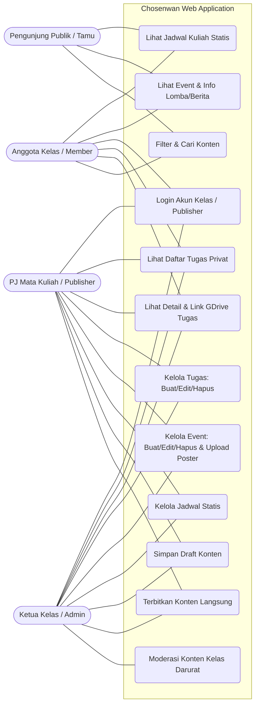
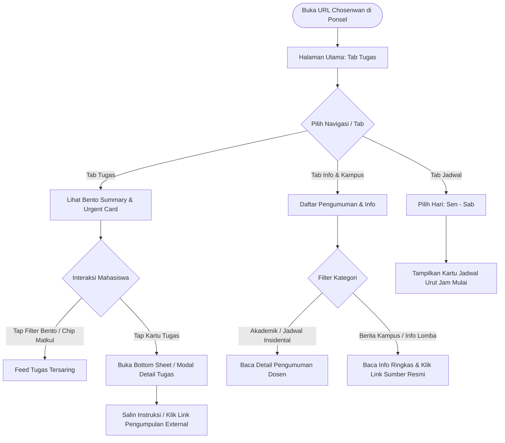
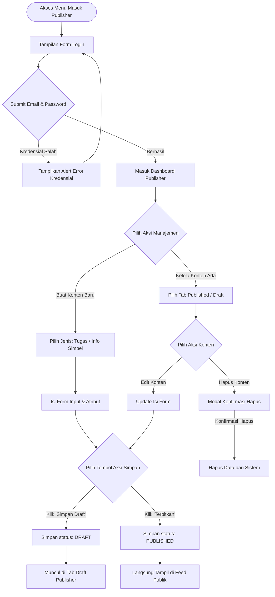
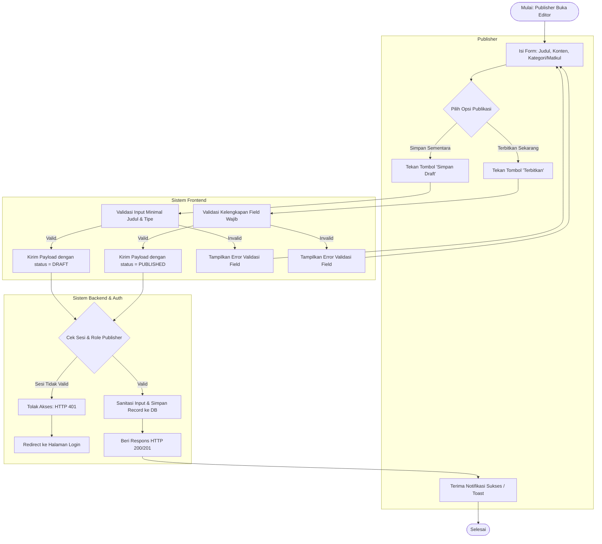
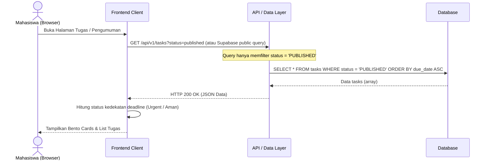
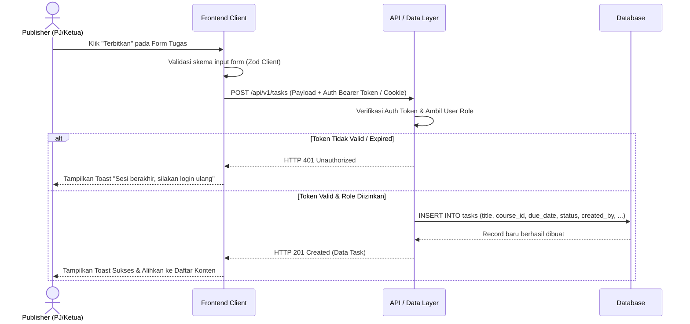
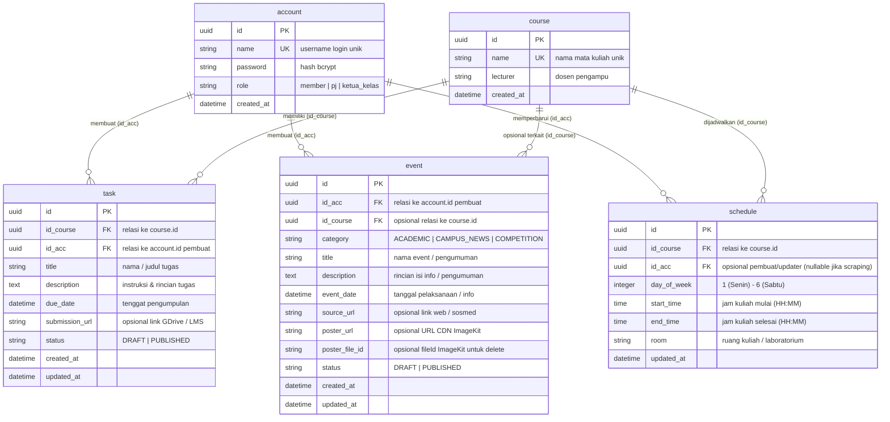
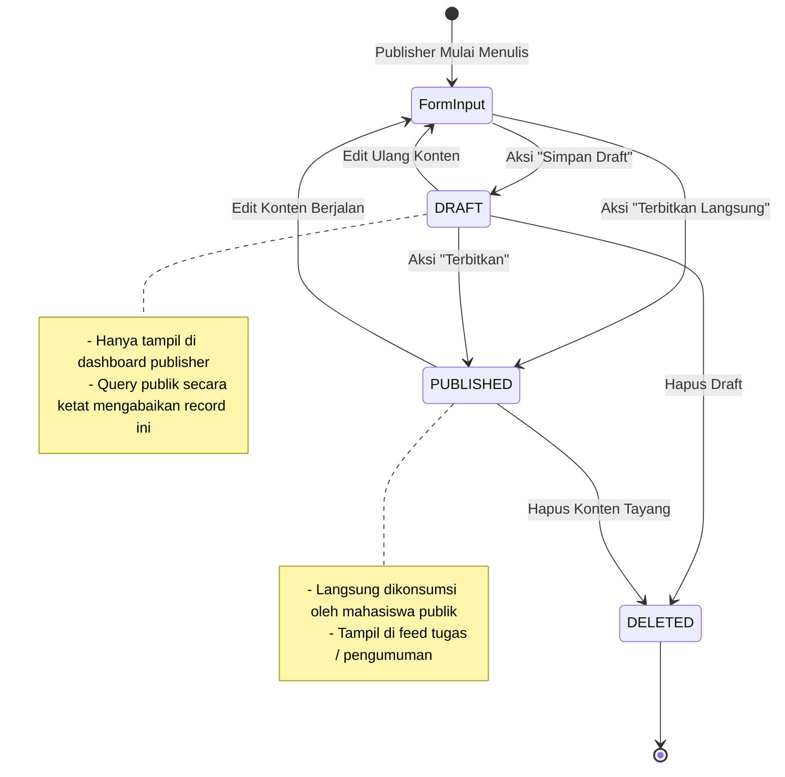

# Spec Teknis: Chosenwan

- **Versi:** 1.4
- **Tanggal:** 2026-11-24
- **Status:** Approved (Penyelarasan Desain ERD & Akses Gated Task v1.4)
- **Sumber input:** `04-prd.md` v1.5, `03-scope.md` v1.2, `05-design.md` v1.0, dokumen desain database ERD serah-terima, serta keputusan arsitektur stack Turso + ImageKit.io.
- **Skill digunakan:** `spec-writer`, `antislop-copywriting`

---

## TL;DR

Chosenwan adalah portal web mobile-first untuk satu kelas pilot yang menyajikan tugas kuliah, jadwal statis per semester, dan event/pengumuman kelas (akademik, perubahan jadwal insidental, berita kampus, dan info lomba) dalam satu wadah terkurasi. 

Pada versi 1.4, arsitektur data diselaraskan dengan dokumen desain ERD final menggunakan 5 tabel relasional terstandarisasi: `account`, `course`, `schedule`, `task`, dan `event`. 

Akses portal dibagi menjadi dua zona keamanan:
1. **Zona Publik (Tanpa Login):** Membuka **Jadwal Kuliah Statis** dan **Event (Berita & Lomba)**.
2. **Zona Privat Anggota Kelas (Wajib Login):** Membuka **Tugas Kuliah (Task)** dan tautan pengumpulan (Google Drive / LMS) untuk mencegah akses pihak luar/kelas lain. Anggota kelas berstatus *Read-Only*.
3. **Pengurus Kelas (Ketua Kelas & PJ):** Mengelola konten secara langsung melalui peran `pj` dan `ketua_kelas` dengan opsi `Draft` atau langsung `Published`.

---

## 1. Ringkasan

### 1.1 Tujuan Produk
Menghilangkan friksi pencarian informasi kuliah yang tertimbun di grup chat WhatsApp atau kanal kampus yang terpecah, menjaga kerahasiaan tautan pengumpulan tugas kelas pilot, serta menyajikan jadwal dan info kegiatan secara cepat dan akurat dalam hitungan detik dari ponsel.

### 1.2 Cakupan Fitur MVP
1. **Akses Publik Tamu (FR-01, FR-07):** Akses baca tanpa login ke Jadwal Kuliah Statis (`schedule`) dan Event / Berita & Lomba (`event`) berstatus `Published`.
2. **Gated Task Khusus Anggota Kelas (FR-01):** Akses halaman tugas wajib login akun anggota kelas (`role = member`). Pengunjung tanpa login ditolak dengan HTTP 401 dan diarahkan ke login.
3. **Otentikasi & Otorisasi Berbasis Peran (FR-02):** Login menggunakan nama anggota (`name`) dan `password` hash dengan 3 tingkat hak akses (`member`, `pj`, `ketua_kelas`).
4. **Manajemen Tugas Terstruktur (FR-03):** Input, update, dan hapus tugas dengan relasi master `course`, tenggat waktu (`due_date`), instruksi (`description`), dan link pengumpulan (`submission_url`).
5. **Manajemen Event & Info Simpel (FR-04):** Satu format entri ringan untuk event akademik, berita kampus, dan info lomba (`event`) dengan dukungan gambar poster via ImageKit.io.
6. **Alur Publikasi Fleksibel (FR-05):** Opsi simpan sebagai `Draft` (hanya terlihat oleh publisher) atau langsung terbitkan (`Published`).
7. **Jadwal Statis Kuliah (FR-06):** Penyajian jadwal terstruktur per hari (Senin-Sabtu) per semester dengan jam mulai–selesai dan ruangan.

### 1.3 Status Tech Stack & Opsi Database
Arsitektur database mengadopsi **Opsi B (Turso + ImageKit.io)** sebagai stack aktif implementasi:
- **Framework:** Next.js (App Router, TypeScript, React 19)
- **Styling & UI Library:** Tailwind CSS + shadcn/ui + Lucide React
- **Backend & Database:** Turso (Edge SQLite / libSQL + Drizzle ORM)
- **Otentikasi & Sesi:** Session berbasis signed HTTP-only cookie + password hash (`bcryptjs`) di tabel `account`
- **Penyimpanan Media & CDN Poster:** ImageKit.io (Forever Free 3 GB storage, 20 GB bandwidth/bulan)
- **Deployment Platform:** Vercel (Auto-deploy dari GitHub)

---

## 2. Aktor Sistem

| Aktor | Deskripsi | Hak Akses Utama |
|---|---|---|
| **Pengunjung Publik (Guest / Tamu)** | Siapa saja yang membuka website tanpa login (dosen, teman luar kelas, mahasiswa belum login). | - Membaca Jadwal Kuliah Statis (`schedule`) berstatus `Published`.<br>- Membaca Event (`event`) berstatus `Published`.<br>- Mencari dan memfilter jadwal & event.<br>- **DITOLAK (HTTP 401)** bila mengakses halaman atau data Tugas. |
| **Anggota Kelas (Member)** | Teman sekelas yang terdaftar dan login dengan akun kelas (`role = member`). | - Seluruh hak akses Pengunjung Publik.<br>- Membuka dan membaca daftar serta detail Tugas Kuliah (`task`) berstatus `Published`.<br>- Mengakses tautan pengumpulan (Google Drive / LMS).<br>- Berstatus **Read-Only** (tidak dapat menambah, mengubah, atau menghapus konten). |
| **PJ Mata Kuliah (Publisher)** | Mahasiswa yang ditunjuk mengoordinasikan satu atau lebih mata kuliah (`role = pj`). | - Seluruh hak akses Anggota Kelas.<br>- Login ke dashboard publisher.<br>- Membuat, mengedit, dan menghapus tugas dan event binaannya.<br>- Menyimpan konten sebagai `Draft` atau langsung `Published`. |
| **Ketua Kelas (Lead Publisher / Admin)** | Koordinator utama kelas pilot (`role = ketua_kelas`). | - Seluruh hak akses PJ Mata Kuliah.<br>- Hak moderasi darurat (*fallback moderator*) untuk seluruh konten kelas.<br>- Menambah atau memperbarui slot jadwal kuliah statis kelas. |

---

## 3. Use Case Diagram (User Diagram)



    UC7 -. include .-> UC10
    UC7 -. include .-> UC11
    UC8 -. include .-> UC10
    UC8 -. include .-> UC11
```

### Tabel Rincian Use Case

| ID | Nama Use Case | Aktor | Prasyarat | Hasil Akhir | Prioritas MVP |
|---|---|---|---|---|---|
| **UC-01** | Lihat Daftar Tugas Publik | Mahasiswa Kelas | Mengakses URL portal | Daftar tugas `Published` tampil terurut tenggat waktu terdekat. | Must Have |
| **UC-02** | Buka Detail & Link Tugas | Mahasiswa Kelas | Tugas terdaftar di sistem | Mahasiswa melihat instruksi lengkap dan dapat mengeklik URL pengumpulan. | Must Have |
| **UC-03** | Lihat Info & Pengumuman | Mahasiswa Kelas | Mengakses tab Info | Menampilkan daftar pengumuman dosen, berita kampus, dan lomba dengan badge kategori. | Must Have |
| **UC-04** | Lihat Jadwal Statis | Mahasiswa Kelas | Mengakses tab Jadwal | Jadwal kuliah per hari tampil urut jam mulai. | Must Have |
| **UC-05** | Filter & Cari Konten | Mahasiswa Kelas | Konten tersedia | Daftar tugas/pengumuman tersaring berdasarkan keyword atau kategori pill. | Should Have |
| **UC-06** | Login Publisher | PJ, Ketua Kelas | Memiliki kredensial email/password valid | Sesi login aktif, diarahkan ke dashboard kelola info. | Must Have |
| **UC-07** | Kelola Tugas | PJ, Ketua Kelas | Login berhasil | Data tugas tersimpan di database dengan status `Draft` atau `Published`. | Must Have |
| **UC-08** | Kelola Pengumuman & Info | PJ, Ketua Kelas | Login berhasil | Data pengumuman tersimpan di database dengan kategori relevan. | Must Have |
| **UC-09** | Kelola Jadwal Statis | PJ, Ketua Kelas | Login berhasil | Data jadwal hari/jam/ruang tersimpan per semester. | Must Have |
| **UC-10** | Simpan Draft | PJ, Ketua Kelas | Input form terisi minimal | Konten tersimpan dengan `status = DRAFT`, tidak bisa dibaca publik. | Must Have |
| **UC-11** | Terbitkan Langsung | PJ, Ketua Kelas | Form valid lengkap | Konten tersimpan dengan `status = PUBLISHED`, langsung tampil di feed publik. | Must Have |
| **UC-12** | Moderasi Fallback Kelas | Ketua Kelas | Login sebagai role `admin` | Ketua kelas dapat memperbaiki atau menghapus postingan milik PJ lain yang berhalangan. | Must Have |

---

## 4. User Flow

### 4.1 Alur Pengalaman Mahasiswa (Konsumsi Informasi Publik)



### 4.2 Alur Pengalaman Publisher (Login, Input, dan Terbit)



---

## 5. Activity Diagram

### 5.1 Proses Input dan Publikasi Konten (Multi-Lane)



### Aturan Bisnis Terkait Publikasi:
1. **Self-Publishing Rights:** PJ mata kuliah dan ketua kelas memiliki hak terbit langsung tanpa antrean persetujuan (*no approval bottleneck*).
2. **Karantina Draft:** Konten dengan status `DRAFT` secara mutlak tidak boleh dikembalikan oleh query publik.
3. **Validasi Wajib Tugas:** Form tugas wajib mengisi `course_id`, `title`, dan `due_date`. Field `week_number`, `submission_url`, dan `notes` bersifat opsional.
4. **Validasi Wajib Info Simpel:** Form info simpel wajib mengisi `title`, `category_type` (`ACADEMIC`, `CAMPUS_NEWS`, atau `COMPETITION`), dan `content`. Khusus kategori `ACADEMIC`, field `course_id` opsional tetapi disarankan. Field link sumber eksternal (`source_url`) opsional namun disarankan untuk berita dan lomba.

---

## 6. Sequence Diagram

### 6.1 Konsumsi Feed Publik oleh Mahasiswa (Guest)



### 6.2 Mutasi Pembuatan Tugas oleh Publisher



---

## 7. Data Model (Database Schema)

### 7.1 Entity Relationship Diagram



### 7.2 Rincian Spesifikasi Tabel dan Field

#### 1. Tabel: `account` (Autentikasi & Otorisasi Pengguna)
Menyimpan kredensial seluruh pengguna kelas terdaftar (anggota kelas biasa maupun pengurus publisher).

| Nama Kolom | Tipe Data (SQLite / PG) | Constraint | Keterangan |
|---|---|---|---|
| `id` | `UUID` / `TEXT` | PK, Default UUID v4 | ID unik akun. |
| `name` | `VARCHAR(100)` / `TEXT` | Unique, Not Null | Nama/username unik untuk login (contoh: `andi`, `budi_pj`). |
| `password` | `TEXT` | Not Null | Password terenkripsi (hash `bcrypt` / `argon2`), bukan teks asli. |
| `role` | `VARCHAR(20)` / `TEXT` | Not Null, Default `'member'` | Peran akses: `'member'` (read-only tugas), `'pj'`, `'ketua_kelas'`. |
| `created_at` | `TIMESTAMP` / `TEXT` | Default `NOW()` / ISO-8601 | Waktu pendaftaran/pembuatan akun. |

#### 2. Tabel: `course` (Master Data Mata Kuliah & Dosen)
Menjadi sumber tunggal data mata kuliah dan dosen pengampu untuk mencegah redudansi dan inkonsistensi. Disiapkan juga untuk menerima *upsert* dari proses scraping di masa depan via constraint unik `name`.

| Nama Kolom | Tipe Data (SQLite / PG) | Constraint | Keterangan |
|---|---|---|---|
| `id` | `UUID` / `TEXT` | PK, Default UUID v4 | ID unik mata kuliah. |
| `name` | `VARCHAR(150)` / `TEXT` | Unique, Not Null | Nama resmi mata kuliah (contoh: "Pemrograman Web"). |
| `lecturer` | `VARCHAR(150)` / `TEXT` | Nullable | Nama dosen pengampu mata kuliah. |
| `created_at` | `TIMESTAMP` / `TEXT` | Default `NOW()` / ISO-8601 | Timestamp penambahan data. |

#### 3. Tabel: `task` (Informasi Tugas Kelas — Area Privat Login)
Menyimpan tugas perkuliahan beserta tenggat dan tautan pengumpulan. Dibatasi secara ketat dan hanya dapat dibaca oleh pengguna yang telah login (`member`, `pj`, `ketua_kelas`).

| Nama Kolom | Tipe Data (SQLite / PG) | Constraint | Keterangan |
|---|---|---|---|
| `id` | `UUID` / `TEXT` | PK, Default UUID v4 | ID unik tugas. |
| `id_course` | `UUID` / `TEXT` | FK -> `course.id`, On Delete Restrict, Not Null | Relasi ke mata kuliah (nama matkul & dosen diambil via join). |
| `id_acc` | `UUID` / `TEXT` | FK -> `account.id`, On Delete Set Null, Nullable | Akun publisher pembuat/pengelola tugas. |
| `title` | `VARCHAR(200)` / `TEXT` | Not Null | Judul tugas (contoh: "Tugas 3: ERD Sistem Kasir"). |
| `description` | `TEXT` | Not Null | Instruksi dan rincian pengerjaan tugas. |
| `due_date` | `TIMESTAMP` / `TEXT` | Not Null, Index | Waktu tenggat pengumpulan tugas. |
| `submission_url` | `VARCHAR(500)` / `TEXT` | Nullable | Tautan pengumpulan privat (Google Drive / Forms / LMS). |
| `status` | `VARCHAR(20)` / `TEXT` | Not Null, Default `'PUBLISHED'`, Index | Status visibilitas: `'DRAFT'` atau `'PUBLISHED'`. |
| `created_at` | `TIMESTAMP` / `TEXT` | Default `NOW()` / ISO-8601 | Timestamp pembuatan entri. |
| `updated_at` | `TIMESTAMP` / `TEXT` | Default `NOW()` / ISO-8601 | Timestamp pembaruan entri. |

*Catatan Normalisasi:* Sesuai rekomendasi Bagian 7.1 Dokumen Desain ERD, kolom redundan `dosen` dan `matkul` dihilangkan dari tabel `task` karena sudah sepenuhnya terelasi ke `course.id`.

#### 4. Tabel: `event` (Event, Berita Kampus, & Info Lomba — Area Publik)
Entitas multi-kategori untuk informasi kegiatan kelas, pengumuman dosen, berita kampus, dan info lomba yang dapat diakses publik.

| Nama Kolom | Tipe Data (SQLite / PG) | Constraint | Keterangan |
|---|---|---|---|
| `id` | `UUID` / `TEXT` | PK, Default UUID v4 | ID unik event/pengumuman. |
| `id_acc` | `UUID` / `TEXT` | FK -> `account.id`, On Delete Set Null, Nullable | Akun publisher pembuat event. |
| `id_course` | `UUID` / `TEXT` | FK -> `course.id`, On Delete Set Null, Nullable | Opsional; terisi jika event terkait mata kuliah spesifik. |
| `category` | `VARCHAR(30)` / `TEXT` | Not Null, Index | Enum kategori: `'ACADEMIC'`, `'CAMPUS_NEWS'`, `'COMPETITION'`. |
| `title` | `VARCHAR(250)` / `TEXT` | Not Null | Judul informasi / nama event / nama lomba. |
| `description` | `TEXT` | Not Null | Rincian lengkap isi pengumuman atau lomba. |
| `event_date` | `DATE` / `TIMESTAMP` / `TEXT` | Not Null | Tanggal kegiatan / tenggat pendaftaran lomba. |
| `source_url` | `VARCHAR(500)` / `TEXT` | Nullable | Link sumber resmi eksternal (Instagram / website kampus). |
| `poster_url` | `VARCHAR(500)` / `TEXT` | Nullable | URL gambar poster teroptimasi dari CDN ImageKit.io. |
| `poster_file_id` | `VARCHAR(150)` / `TEXT` | Nullable | File ID ImageKit.io untuk pembersihan (*delete*) otomatis. |
| `status` | `VARCHAR(20)` / `TEXT` | Not Null, Default `'PUBLISHED'`, Index | Status: `'DRAFT'` atau `'PUBLISHED'`. |
| `created_at` | `TIMESTAMP` / `TEXT` | Default `NOW()` / ISO-8601 | Timestamp publikasi. |
| `updated_at` | `TIMESTAMP` / `TEXT` | Default `NOW()` / ISO-8601 | Timestamp pengeditan terakhir. |

#### 5. Tabel: `schedule` (Jadwal Kuliah Statis — Area Publik)
Jadwal kuliah mingguan kelas pilot per semester.

| Nama Kolom | Tipe Data (SQLite / PG) | Constraint | Keterangan |
|---|---|---|---|
| `id` | `UUID` / `TEXT` | PK, Default UUID v4 | ID unik slot jadwal. |
| `id_course` | `UUID` / `TEXT` | FK -> `course.id`, On Delete Restrict, Not Null | Relasi ke master mata kuliah. |
| `id_acc` | `UUID` / `TEXT` | FK -> `account.id`, On Delete Set Null, Nullable | Publisher pengelola jadwal (boleh `NULL` untuk scraper otomatis). |
| `day_of_week` | `INTEGER` | Not Null, Check (1-6), Index | `1` = Senin, `2` = Selasa, ..., `6` = Sabtu. |
| `start_time` | `TIME` / `VARCHAR(10)` | Not Null | Jam mulai kuliah (format `HH:MM`, misal `08:00`). |
| `end_time` | `TIME` / `VARCHAR(10)` | Not Null | Jam selesai kuliah (format `HH:MM`, misal `10:30`). |
| `room` | `VARCHAR(50)` / `TEXT` | Not Null | Ruangan / laboratorium kuliah (contoh: "Lab Komputer 3"). |
| `updated_at` | `TIMESTAMP` / `TEXT` | Default `NOW()` / ISO-8601 | Timestamp pembaruan terakhir. |

*Catatan Normalisasi:* Kolom redundan `course` dan `lecturer` dihapus dari `schedule`; data diambil dinamis lewat `JOIN course`. Kolom `id_acc` bersifat `Nullable` agar skrip proses scraping terjadwal dapat meng-insert data tanpa gagal constraint foreign key.

---

## 8. State Diagram

### Siklus Hidup Entitas Konten (Tugas & Pengumuman)



---

## 9. API & Interface Contract

Format API ditulis dalam pola RESTful standar (diimplementasikan via Next.js Server Actions dan Route Handlers tervalidasi).

### 9.1 Ringkasan Endpoint

| Method | Endpoint Path | Autentikasi | Deskripsi Singkat | Use Case Terkait |
|---|---|---|---|---|
| `GET` | `/api/v1/schedules` | Public (Tanpa Auth) | Mengambil jadwal statis kuliah per hari | UC-01 |
| `GET` | `/api/v1/events` | Public (Tanpa Auth) | Mengambil event, berita kampus, dan info lomba (`status = PUBLISHED`) | UC-02, UC-06 |
| `GET` | `/api/v1/courses` | Public (Tanpa Auth) | Mengambil master mata kuliah untuk filter | UC-06 |
| `POST` | `/api/v1/auth/login` | Public | Otentikasi nama anggota (`name`) dan `password` | UC-03 |
| `POST` | `/api/v1/auth/logout` | Session Aktif | Mengakhiri sesi login | UC-03 |
| `GET` | `/api/v1/tasks` | **Member / Publisher Session** | Mengambil daftar tugas kelas (`status = PUBLISHED`). Menolak publik (HTTP 401) | UC-04, UC-06 |
| `GET` | `/api/v1/tasks/:id` | **Member / Publisher Session** | Mengambil detail spesifik tugas dan link pengumpulan GDrive | UC-05 |
| `GET` | `/api/v1/publisher/contents` | Publisher Session (`pj`/`ketua_kelas`) | Mengambil seluruh konten milik publisher (Draft + Published) | UC-07, UC-08 |
| `POST` | `/api/v1/tasks` | Publisher Session (`pj`/`ketua_kelas`) | Membuat entri tugas baru (Draft / Published) | UC-07, UC-10, UC-11 |
| `PUT` | `/api/v1/tasks/:id` | Publisher Session (`pj`/`ketua_kelas`) | Memperbarui entri tugas | UC-07 |
| `DELETE` | `/api/v1/tasks/:id` | Publisher Session (`pj`/`ketua_kelas`) | Menghapus entri tugas | UC-07, UC-12 |
| `POST` | `/api/v1/events` | Publisher Session (`pj`/`ketua_kelas`) | Membuat event / info simpel / upload poster | UC-08, UC-10, UC-11 |
| `PUT` | `/api/v1/events/:id` | Publisher Session (`pj`/`ketua_kelas`) | Memperbarui event | UC-08 |
| `DELETE` | `/api/v1/events/:id` | Publisher Session (`pj`/`ketua_kelas`) | Menghapus event (membersihkan poster ImageKit) | UC-08, UC-12 |
| `PUT` | `/api/v1/schedules/:id` | Admin Session (`ketua_kelas`) | Memperbarui data jadwal statis | UC-09 |

---

### 9.2 Skema Request dan Response Kunci

#### 1. `POST /api/v1/auth/login`
- **Request Body:**
```json
{
  "name": "andi",
  "password": "password123"
}
```
- **Response `200 OK` (Berhasil):**
```json
{
  "success": true,
  "user": {
    "id": "e5b7b6c2-4e2b-4835-97e3-0d5b78b5e28a",
    "name": "andi",
    "role": "member"
  }
}
```

#### 2. `GET /api/v1/tasks` (Akses Privat Anggota Kelas)
- **Headers:** Memerlukan Cookie Sesi Aktif (`session_token`)
- **Query Params:**
  - `id_course` (opsional): filter ID mata kuliah.
  - `filter` (opsional): `all` | `upcoming` | `past`.
- **Response `200 OK`:**
```json
{
  "success": true,
  "data": [
    {
      "id": "e5b7b6c2-4e2b-4835-97e3-0d5b78b5e28a",
      "course": {
        "id": "c1a9f0e1-7d3a-4428-b80c-235882f0df71",
        "name": "Interaksi Manusia dan Komputer",
        "lecturer": "Dr. Eng. Budi"
      },
      "title": "Tugas 3: Perancangan UI Mobile High-Fidelity",
      "description": "Buat 4 frame aplikasi mobile menggunakan Figma. Kumpulkan file link sebelum batas waktu.",
      "due_date": "2026-11-20T23:59:00+07:00",
      "submission_url": "https://drive.google.com/drive/folders/example",
      "status": "PUBLISHED",
      "created_at": "2026-11-17T08:00:00+07:00"
    }
  ]
}
```
- **Response `401 Unauthorized` (Jika diakses publik tanpa login):**
```json
{
  "success": false,
  "error": "UNAUTHORIZED",
  "message": "Halaman tugas hanya dapat diakses oleh anggota kelas yang sudah login."
}
```

#### 3. `POST /api/v1/events` (Publisher Action)
- **Request Body (Contoh: Info Lomba dengan Poster ImageKit):**
```json
{
  "id_course": null,
  "category": "COMPETITION",
  "title": "Gemastik 2026 Divisi UX Design",
  "description": "Pendaftaran babak penyisihan dibuka sampai akhir bulan. Hadiah total puluhan juta rupiah.",
  "event_date": "2026-12-15",
  "source_url": "https://pusatprestasinasional.kemdikbud.go.id/gemastik",
  "poster_url": "https://ik.imagekit.io/chosenwan/posters/gemastik_xyz.jpg",
  "poster_file_id": "file_xyz12345",
  "status": "PUBLISHED"
}
```
- **Response `201 Created`:**
```json
{
  "success": true,
  "message": "Event berhasil diterbitkan",
  "data": {
    "id": "a901842e-128a-4efb-8871-3382901a88b1",
    "status": "PUBLISHED"
  }
}
```
    "id": "a901842e-128a-4efb-8871-3382901a88b1",
    "category_type": "COMPETITION",
    "status": "PUBLISHED"
  }
}
```

---

## 10. Struktur Komponen dan Folder

Sesuai preferensi arsitektur di `profile.md` bagian 9, antarmuka Chosenwan **tidak membuat komponen custom dari nol**. Seluruh elemen dipetakan secara ketat ke library komponen siap pakai yang terawat (*radix-ui/shadcn/ui*, Tailwind CSS, dan Lucide Icons) dengan token visual dari `05-design.md`.

### 10.1 Pemetaan Kebutuhan UI ke Library Standar

| Kebutuhan UI / Fungsi | Library atau Komponen Siap Pakai | Catatan & Mapping Desain |
|---|---|---|
| **Bento Summary & Content Cards** | `shadcn/ui Card` + Tailwind utility classes | Radius besar (`rounded-2xl` / `rounded-3xl`), border tipis, flat styling tanpa drop shadow tebal. |
| **Dark Anchor Card (Urgent)** | `shadcn/ui Card` varian khusus (`bg-[#111318] text-white`) | Kartu kontras tinggi untuk tugas dengan deadline paling dekat. |
| **Navigasi Tab Halaman & Kategori** | `shadcn/ui Tabs` | Mengatur perpindahan tab `Tugas`, `Info & Kampus`, `Jadwal`, dan sub-filter kategori. |
| **Pill Badges & Status Deadline** | `shadcn/ui Badge` | Menggunakan pill penuh (`rounded-full`) dengan token warna pastel (`#A8C0FF`, `#F6C866`, `#EA9DFB`, `#4CD98B`, `#F05252`). |
| **Tombol Aksi & CTA Kapsul** | `shadcn/ui Button` | Varian kapsul penuh (`rounded-full`). Hitam `#111318` untuk aksi primer, netral `#EEF1F6` untuk sekunder. |
| **Modal Konfirmasi & Form Dialog** | `shadcn/ui Dialog` / `Sheet` (Bottom Drawer) | Bottom sheet pada mobile untuk detail tugas dan konfirmasi penghapusan data. |
| **Form Input & Textarea** | `shadcn/ui Input`, `Textarea`, `Label` | Sudut membulat `rounded-xl`, latar `#EEF1F6` / putih, fokus border `#111318`. |
| **Pilihan Dropdown Matkul** | `shadcn/ui Select` | Pemilih mata kuliah terstandarisasi saat publisher menginput tugas/pengumuman. |
| **Feedback / Toast Notifikasi** | `sonner` (atau `shadcn/ui Toast`) | Menampilkan pesan sukses *"Info berhasil diterbitkan"* atau alert error jaringan. |
| **Ikon Sistem** | `lucide-react` | Paket ikon outline seragam stroke 1.75px (`Calendar`, `Clock`, `BookOpen`, `Megaphone`, `Trophy`, `ExternalLink`, dll). |
| **Validasi Form & State** | `react-hook-form` + `zod` | Validasi skema client-side yang ketat sebelum mengirim payload ke server. |

---

### 10.2 Struktur Hierarki Komponen UI (Component Tree)

```text
AppContainer (max-w-md mx-auto, min-h-screen, bg-[#F6F7FB])
├── TopHeader (Identitas Kelas "Chosenwan Pilot", Tombol Masuk/Kelola Publisher)
├── MainContent (Dynamic View based on active tab)
│   ├── TasksView (Tab: Tugas)
│   │   ├── SearchAndFilterBar (Input Search + Course Select Filter)
│   │   ├── BentoSummaryGrid (2x2 Quick Tiles: Total, Mendesak, Berita, Lomba)
│   │   ├── UrgentTaskCard (Dark Anchor Card: bg-[#111318], Countdown Jam)
│   │   ├── TaskList (Regular White Cards)
│   │   │   └── TaskCard (Badge Matkul, Judul, Deadline, CTA Buka Link)
│   │   └── TaskDetailSheet (Bottom Sheet: Full Instructions, Copy Link)
│   │
│   ├── InfoView (Tab: Info & Kampus)
│   │   ├── CategoryPillsFilter (Semua | Akademik | Berita Kampus | Info Lomba)
│   │   └── AnnouncementList
│   │       └── AnnouncementCard (Badge Kategori Pastel, Judul, Cuplikan Isi, Source Link)
│   │
│   ├── SchedulesView (Tab: Jadwal Kuliah)
│   │   ├── DaySelectorStrip (Horizontal Days: Sen - Sab, Active Day Indicator)
│   │   └── ScheduleTimeline
│   │       └── ScheduleSlotCard (Jam Mulai-Selesai, Nama Matkul, Ruangan, Dosen)
│   │
│   └── PublisherView (Protected Route: Kelola Konten)
│       ├── PublisherTabs (Published Items | Drafts)
│       ├── ContentEditorForm
│       │   ├── ContentTypeToggle (Segmented Pill: Tugas vs Info Simpel)
│       │   ├── DynamicFields (Course, Deadline, Instructions / Category, Source URL)
│       │   └── FormActionsBar (Tombol "Simpan Draft" & Tombol Primer "Terbitkan")
│       └── DeleteConfirmDialog (Peringatan & Konfirmasi Hapus Konten)
│
└── BottomNavigationBar (Fixed Docked Pill: Tugas, Info & Kampus, Jadwal, [Kelola])
```

---

### 10.3 Struktur Folder Konvensional

Struktur folder dirancang sederhana, modular, dan mengikuti konvensi standar agar ramah untuk debugging oleh manusia maupun AI coding agent:

```text
chosenwan-app/
├── public/                     # Aset statis & favicon
├── src/
│   ├── app/                    # Routing halaman (misal Next.js App Router / Pages)
│   │   ├── layout.tsx          # Root mobile container (max-w-md center)
│   │   ├── page.tsx            # Halaman utama (Public Home / Tabs)
│   │   ├── login/
│   │   │   └── page.tsx        # Halaman autentikasi publisher
│   │   └── publisher/
│   │       └── page.tsx        # Dashboard publisher (Protected)
│   │
│   ├── components/
│   │   ├── ui/                 # Komponen dasar dari shadcn/ui (Button, Card, Badge, Dialog, etc.)
│   │   ├── layout/             # TopHeader, BottomNav, MobileContainer
│   │   ├── tasks/              # BentoGrid, UrgentTaskCard, TaskCard, TaskDetailSheet
│   │   ├── info/               # AnnouncementCard, CategoryFilter
│   │   ├── schedule/           # DaySelector, ScheduleSlotCard
│   │   └── publisher/          # ContentEditorForm, ContentTable, DeleteDialog
│   │
│   ├── lib/
│   │   ├── db.ts               # Koneksi database / Supabase client instance
│   │   ├── validations.ts      # Skema Zod untuk form tugas & pengumuman
│   │   ├── utils.ts            # Helper formatting tanggal (date-fns / dayjs) & cn helper
│   │   └── constants.ts        # Daftar hari, opsi kategori, badge colors
│   │
│   └── types/
│       └── index.ts            # TypeScript interfaces (Task, Announcement, Schedule, Course, User)
├── .env.example                # Template environment variables
├── package.json
├── tailwind.config.ts          # Definisi color tokens Playful Bento dari 05-design.md
└── tsconfig.json
```

---

## 11. Aturan Bisnis, Edge Case, dan Error Handling

| Skenario | Perilaku Sistem yang Diharapkan | Tampilan UI / Pesan Error |
|---|---|---|
| **Tidak ada tugas atau pengumuman aktif** | Sistem mendeteksi array kosong dari database. | Tampilkan *Empty State* ramah: ilustrasi minimalis + teks *"Hore, belum ada tugas aktif minggu ini! Santai dulu."* |
| **Tugas sudah lewat deadline (*past due*)** | Tugas tetap bisa diakses mahasiswa namun status deadline berubah otomatis. | Badge merah berubah menjadi abu-abu pudar bertuliskan *"Tenggat Terlewat"*; kartu bergeser ke bawah daftar. |
| **Koneksi internet terputus saat membuka portal** | Client gagal melakukan fetch data ke server. | Tampilkan banner kartu peringatan di atas: *"Gagal memuat info terbaru. Periksa koneksi internetmu."* + tombol *"Coba Lagi"*. |
| **Double Submit form oleh publisher** | Cegah duplikasi pengiriman data saat tombol ditekan berkali-kali. | Disable tombol *"Terbitkan"* / *"Simpan Draft"* seketika setelah klik pertama, ganti teks tombol dengan spinner loading. |
| **Input form tidak lengkap atau format URL salah** | Validasi client-side via Zod menolak submit form. | Highlight input yang bermasalah dengan garis merah tipis dan teks peringatan di bawah kolom (misal: *"Format tautan harus diawali https://"*). |
| **Sesi login publisher habis (Token Expired)** | Mutasi data ke backend ditolak dengan status HTTP 401. | Tampilkan Toast: *"Sesi login berakhir. Silakan masuk kembali."* dan alihkan publisher secara halus ke form login tanpa kehilangan input bila memungkinkan. |
| **Publisher non-ketua mencoba mengedit postingan orang lain** | Otorisasi di tingkat database / backend menolak query update. | HTTP 403 Forbidden. UI menampilkan pesan *"Kamu hanya dapat mengedit postingan yang kamu buat sendiri."* |
| **Tautan pengumpulan tugas berupa teks biasa** | Dosen memberikan link Google Classroom tanpa skema protokol. | Helper otomatis menyematkan prefix `https://` atau menampilkan teks petunjuk jika format bukan URL yang dapat diklik. |

---

## 12. Persyaratan Non-Fungsional (NFR)

1. **Performa & Latensi (Mobile Network Friendly):**
   - Halaman publik pertama kali dibuka (*First Contentful Paint*) ditargetkan `< 1.8 detik` pada jaringan 4G standar ponsel mahasiswa.
   - Ukuran bundel JavaScript awal diminimalkan dengan memanfaatkan *code-splitting* bawaan framework modern.
2. **Keamanan & Otorisasi:**
   - Konten berstatus `DRAFT` dilindungi di tingkat query database (misalnya via *PostgreSQL Row-Level Security* / RLS), bukan sekadar difilter di sisi client JavaScript, sehingga data rahasia/draft tidak bocor melalui *Network Tab / DevTools*.
   - Password publisher di-*hash* menggunakan algoritma kuat (misal `bcrypt` / `argon2`) bawaan engine auth standar.
3. **Aksesibilitas & Kontras:**
   - Mengikuti aturan kontras di `05-design.md`: Seluruh teks di atas badge atau blok warna pastel (`#A8C0FF`, `#F6C866`, `#EA9DFB`) wajib menggunakan warna gelap **Deep Jet Charcoal (`#111318`)**, bukan putih.
   - Ukuran target ketukan jari (*touch targets*) untuk seluruh tombol dan tab minimal `44 × 44 px` agar nyaman ditekan jempol di layar ponsel.

---

## 13. Matriks Ketertelusuran (Traceability Matrix)

| Requirement PRD | Use Case | Komponen & Flow | Endpoint / Query Data | Entitas Database Terkait |
|---|---|---|---|---|
| **FR-01 (Akses Informasi Publik)** | UC-01, UC-03, UC-04 | TasksView, InfoView, SchedulesView | `GET /api/v1/tasks`, `GET /api/v1/announcements` | `tasks` (`status='PUBLISHED'`), `announcements` |
| **FR-02 (Akses & Otorisasi Publisher)** | UC-06, UC-12 | LoginView, PublisherDashboard | `POST /api/v1/auth/login`, Middleware Auth | `profiles` (`role='pj_matkul'/'ketua_kelas'`) |
| **FR-03 (Manajemen Tugas)** | UC-07, UC-02 | ContentEditorForm, TaskDetailSheet | `POST/PUT/DELETE /api/v1/tasks` | `tasks`, `courses` |
| **FR-04 (Pengumuman & Info Simpel)** | UC-08, UC-03 | ContentEditorForm, InfoView | `POST/PUT/DELETE /api/v1/announcements` | `announcements` (`category_type`) |
| **FR-05 (Publikasi Langsung & Draft)** | UC-10, UC-11 | FormActionsBar (`Simpan Draft` vs `Terbitkan`) | Payload field `status` (`DRAFT`/`PUBLISHED`) | `tasks.status`, `announcements.status` |
| **FR-06 (Jadwal Kuliah Statis)** | UC-04, UC-09 | SchedulesView, DaySelectorStrip | `GET/PUT /api/v1/schedules` | `schedules`, `courses` |
| **FR-07 (Pemisahan Tab & Filter)** | UC-05 | BottomNavigationBar, SearchAndFilterBar | Client-side search / filter queries | `tasks`, `announcements`, `courses` |

---

## 14. Keputusan Tech Stack & Pertanyaan Terbuka

### 14.1 Keputusan Tech Stack & Opsi Database

#### Opsi A — Supabase (PostgreSQL) *(Baseline Approved - Gate 3)*
- **Frontend & Fullstack API:** Next.js (App Router, TypeScript)
- **Desain & UI Components:** Tailwind CSS + shadcn/ui + Lucide React
- **Backend, Auth, DB, & Storage:** Supabase (PostgreSQL, Supabase Auth `@supabase/ssr`, Row Level Security, Supabase Storage 1 GB)
- **Deployment Platform:** Vercel + Supabase Cloud Free Tier

**Kelebihan & Trade-off Opsi A:**
1. **Paket All-in-One:** Database, Auth email/password, RLS, dan Storage poster tersedia dalam satu SDK tanpa merangkai layanan terpisah.
2. **Keamanan Data di Level DB (RLS):** Filter `status = 'PUBLISHED'` dan hak edit `created_by = auth.uid()` dijaga langsung oleh PostgreSQL RLS.
3. **Catatan Free Tier:** Maksimal 2 project aktif, DB 500 MB, serta memiliki kebijakan **auto-pause setelah 7 hari tanpa aktivitas** (harus di-resume manual bila lama tidak ada query, misal saat libur semester).

---

#### Opsi B — Turso (libSQL / Edge SQLite) + ImageKit.io *(Stack Aktif v1.4)*
- **Frontend & Fullstack API:** Next.js (App Router, TypeScript)
- **Database & Query Layer:** Turso (`@libsql/client` + Drizzle ORM dengan skema SQLite)
- **Auth & Session:** Dikelola di server Next.js (signed HTTP-only cookie + hash `bcryptjs` di tabel `account`)
- **Media Storage & CDN Poster:** **ImageKit.io** (Forever Free: **3 GB storage**, **20 GB bandwidth/bulan**, tanpa wajib kartu kredit, optimasi CDN & resize URL otomatis)

**Perbandingan Singkat (Supabase vs Turso + ImageKit.io untuk Chosenwan):**

| Aspek | Opsi A: Supabase (PostgreSQL) | Opsi B: Turso + ImageKit.io |
|---|---|---|
| **Engine DB** | PostgreSQL terkelola | libSQL (fork open-source SQLite) di edge |
| **Free Tier DB** | 2 project, 500 MB DB, 5 GB egress | 100 database, 5 GB storage, 500 juta row reads/bln, 10 juta row writes/bln |
| **Risiko Auto-Pause** | Auto-pause jika 7 hari tidak ada aktivitas | Tidak kena auto-pause mingguan |
| **Auth & Session** | Bawaan (`Supabase Auth`) | Dikelola di Next.js server (session cookie + password hash di tabel `account`) |
| **Isolasi Draft / Role** | PostgreSQL RLS otomatis di level tabel | Dijaga di Next.js Server Actions / API Route Handlers (`member`, `pj`, `ketua_kelas`) |
| **Upload & CDN Poster** | Bawaan (`Supabase Storage`, 1 GB) | **ImageKit.io** (3 GB storage, 20 GB bandwidth/bln, CDN + resize URL, tanpa kartu kredit) |
| **Kesiapan Skema** | Tipe native `UUID`, `TIMESTAMPTZ`, `TIME` | Penyesuaian minor ke tipe SQLite (`TEXT` ISO-8601, `INTEGER` check 1–6) |

**Catatan Implementasi Stack Turso + ImageKit.io:**
1. **Jangan Ekspos Secret ke Browser:** Token Turso dan `IMAGEKIT_PRIVATE_KEY` hanya boleh berada di server (`.env.local`). Seluruh query DB maupun upload/hapus file ImageKit harus melewati Next.js Server Components, Server Actions, atau Route Handlers yang tervalidasi.
2. **Guard Query Privat Tugas Mutlak:** Endpoint/loader tugas (`task`) wajib memverifikasi sesi login pengguna (role `member`, `pj`, atau `ketua_kelas`). Pengunjung publik tanpa sesi login langsung ditolak dengan status HTTP 401.
3. **Guard Query Publik Event & Jadwal:** Endpoint/loader publik untuk `event` dan `schedule` menyertakan `WHERE status = 'PUBLISHED'`; mutasi edit/hapus wajib memverifikasi hak publisher (`role in ('pj', 'ketua_kelas')`).
4. **Alur Poster ImageKit.io:** Gambar hasil kompresi client (`compressPosterImage`) dikirim ke endpoint/Server Action Next.js terautentikasi untuk di-upload ke ImageKit (folder `/chosenwan/posters`), lalu `response.url` disimpan ke `poster_url` dan `response.fileId` ke `poster_file_id`. Bila poster diganti atau event dihapus, server menghapus file lama memakai `poster_file_id` agar kuota 3 GB tetap bersih dari *orphan files*.

---

### 14.2 Daftar Asumsi dan Pertanyaan Terbuka (Open Questions)

- `[ASUMSI]` Akun anggota kelas (`member`) dibagikan/dibuatkan oleh ketua kelas atau tim pengelola dengan username unik (`name`) dan password standar.
- `[ASUMSI]` Tautan pengumpulan tugas diarahkan langsung ke platform eksternal (Google Drive, Google Forms, atau Google Classroom) yang aman dan hanya dapat diakses oleh anggota kelas berwenang.

---

## 15. Out of Scope (Future Roadmap)

Fitur-fitur berikut secara eksplisit berada di luar scope spesifikasi teknis MVP dan disiapkan untuk diimplementasikan pada tahap selanjutnya:
1. **Scraping Otomatis Jadwal & Mata Kuliah:** Penarikan otomatis jadwal kuliah dan data dosen dari portal akademik kampus / SIAKAD secara terjadwal. Arsitektur tabel `course` (dengan constraint unik `name`) dan tabel `schedule` (dengan `id_acc` nullable) sudah disiapkan agar kompatibel menerima injeksi data scraper di masa depan tanpa mengubah skema tabel.
2. **LLM / AI Chat Parser:** Fitur ekstraksi pesan chat WhatsApp (dari dosen/grup) langsung menjadi form tugas atau event. Arsitektur form berbasis Zod schema sudah siap menerima payload JSON terstruktur dari API Gemini / model bahasa di masa depan.
3. **Sistem Notifikasi Push / WhatsApp Gateway Otomatis:** Pengiriman notifikasi otomatis saat ada tugas baru dibuat.
4. **Penyimpanan File Tugas Internal:** Pengunggahan file tugas langsung ke penyimpanan server Chosenwan (tetap diarahkan ke Google Drive/LMS).
5. **Pelacakan Status Progres Mahasiswa:** Fitur checklist pribadi *"Tugas Selesai"* atau penghitungan persentase tugas.
6. **Kalender Dinamis & Recurrence Engine:** Logika perhitungan libur nasional atau sinkronisasi dengan Google Calendar.
7. **Portal Multi-Kelas / Multi-Jurusan:** Manajemen hak akses berjenjang untuk banyak kelas di kampus.

---

## Changelog

| Versi | Tanggal | Catatan Perubahan |
|---|---|---|
| **1.0** | 2026-11-17 | Pembuatan dokumen spesifikasi teknis awal (Draft) dari `04-prd.md` v1.4 dan `05-design.md` v1.0. Mencakup use case diagram, user flow, activity diagram, sequence diagram, data model ERD, state diagram, API contract, pemetaan komponen UI library standar, aturan edge case, traceability matrix, dan usulan 2 opsi tech stack. |
| **1.1** | 2026-11-17 | Status Approved (Gate 3). Tech stack resmi dikunci pada Opsi A: Next.js + Tailwind CSS + shadcn/ui + Supabase (Auth, PostgreSQL, RLS) + Vercel Deployment sesuai persetujuan Lead PM. |
| **1.2** | 2026-11-20 | Menambahkan kolom `poster_url` pada tabel `announcements` serta menambahkan **Opsi B: Turso (libSQL / SQLite)** beserta tabel perbandingan dan catatan implementasi di Section 1.3 dan Section 14.1. |
| **1.3** | 2026-11-20 | Mengunci **Opsi B: Turso (libSQL / SQLite) + ImageKit.io** sebagai stack aktif backend & media storage poster, menambahkan kolom `poster_file_id` pada `announcements`, serta merinci alur upload/hapus poster ImageKit.io. |
| **1.4** | 2026-11-24 | Menyelaraskan skema database dengan dokumen desain ERD serah-terima: mengadopsi 5 tabel standar (`account`, `course`, `schedule`, `task`, `event`), menghapus kolom redundan di `task` dan `schedule`, memproteksi halaman Tugas khusus anggota kelas yang login (`role = member` / HTTP 401 jika publik), serta mencatat arsitektur fitur Scraping dan LLM Parser ke Out of Scope (Future Roadmap). |
